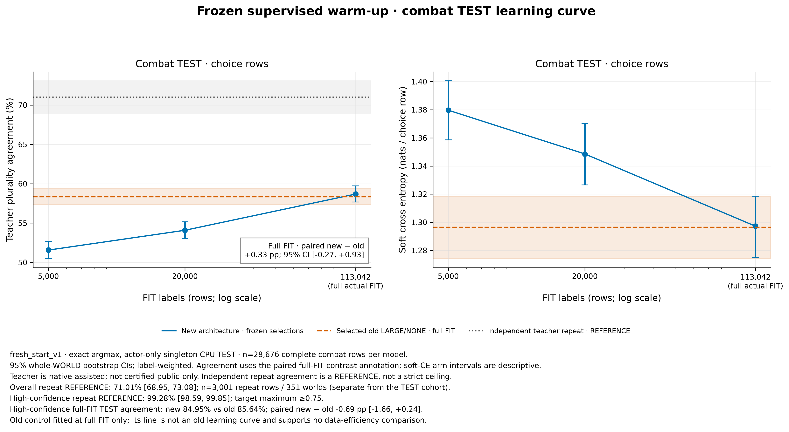
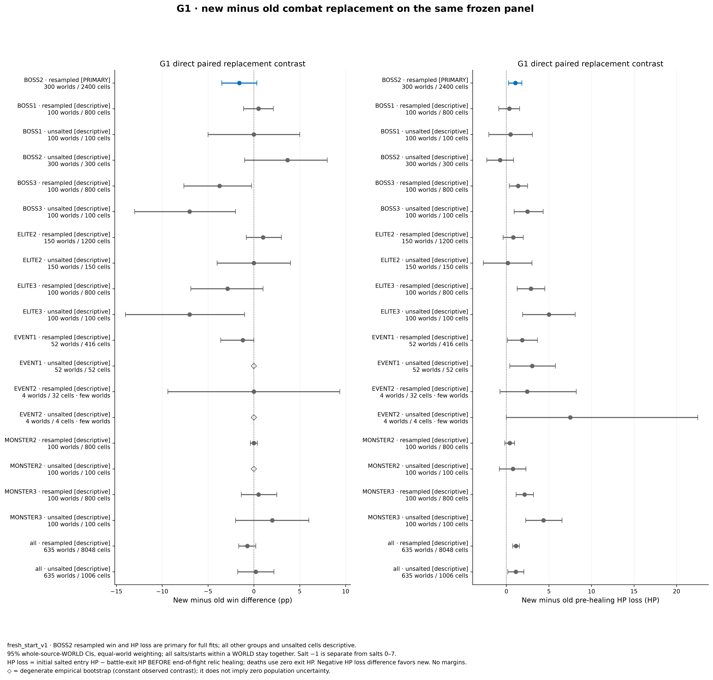
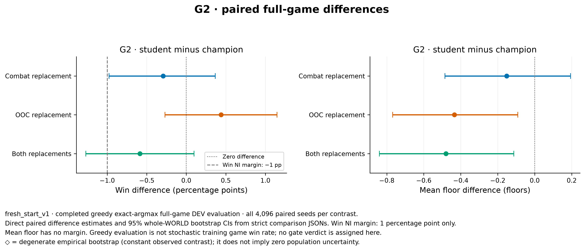

# Fresh-start Gate C — 16 October 2026

**Gate C complete. Step D and the confirmation set remain unopened.**

The study did not establish the intended representation advantage, and the full fresh composite did not establish non-inferiority. Keep the champion as the default. Both phase replacements individually met the predeclared win-margin rule, but combining them did not inherit that result.

## Primary decisions

**G1 is not met.** On 28,676 combat TEST states from 363 held-out worlds, the structured model agrees with the search teacher on 58.68%, versus 58.35% for the old encoder. The paired difference is +0.33 percentage points, 95% world-clustered CI [−0.27, +0.93]. This does not demonstrate the required copying advantage. TEST soft cross-entropy is 1.29719 versus 1.29646; their point estimates are very close (old is lower/better by 0.0007; no paired CE-difference CI was estimated). High-confidence means the same multi-action TEST states for both models where the teacher plurality has at least 18 of 24 votes (75%). On these 6,791 choices, agreement is 84.95% versus 85.64%, paired difference −0.69 points [−1.66, +0.24].

The primary Act 2 boss panel also does not support “no worse.” Across 300 source worlds × 8 resamples, new minus old is −1.58 win points [−3.50, +0.33] and **+1.05 HP lost [+0.26, +1.83]**. The new model loses measurably more HP. HP is measured before end-of-fight relic healing, with death HP set to zero. Panel win points refer to per-fight win rates. Other room/act panels are descriptive; Act 3 boss wins are lower by 3.75 points [−7.63, −0.25], and pooled resampled HP lost is +1.14 [+0.74, +1.54], both unadjusted secondary intervals. HP loss combines damage in survived fights and deaths scored at zero exit HP; the mechanism is not identified.

The primary panel contrast has bootstrap SE **0.98 win points / 0.39 HP**, with approximate 80%-power MDE **2.76 points / 1.10 HP**. Limited win sensitivity means absence of a detected win decline would not establish non-inferiority. [Every panel's estimates, SE and MDE](assets/nonllm/fresh_start_gate_c_20261016/g1_panel_sensitivity.csv) are retained, including unsalted controls and rare groups.

The held-out room/act contrasts are in [the direct paired table](assets/nonllm/fresh_start_gate_c_20261016/g1_paired_label_groups.csv); per-act, room and joint strata for each model are in [the TEST strata table](assets/nonllm/fresh_start_gate_c_20261016/test_strata.csv). Only Act 2 hallways among ten joint groups have a positive agreement interval excluding zero (+1.62 points [+0.15, +3.10], unadjusted); the largest group, Act 2 bosses, is −0.31 [−1.23, +0.62]. These do not rescue the pooled G1 result.

**G2 for the full fresh composite is inconclusive.** The lower win-difference bound crosses the −1-point non-inferiority margin, while the interval also crosses zero. This is neither a pass nor evidence of a statistically clear win-rate decline. Mean floor is lower. All planned evaluations were retained despite the unmet G1 condition.

## Paired 4,096-world DEV evaluation

Champion on environment 0.1.5: **143/4096 wins (3.49%; 95% CI 2.95–4.05%)**, mean floor **35.17 [34.86, 35.49]**. These are fresh 0.1.5 results; no numerical comparison with older environment results is made.

Differences below are student minus champion. Win differences and their intervals are percentage points; floor differences are floors. Sid explicitly approved the 1-point absolute win margin in the pre-run clarification; it was recorded at 21:50 UTC before evaluation. One point is about 29% of the fresh champion's 3.49% win rate, so passing this margin is a limited claim. The win margin is 1 point only. PASS means the lower two-sided 95% bootstrap bound is above −1 point; otherwise FAIL means the whole interval is below zero; otherwise INCONCLUSIVE. No margins apply to floor, HP or boss rates.

| Condition | Wins | Win difference [95% CI], pp | Win-margin rule | Mean floor difference [95% CI] |
|---|---:|---:|---|---:|
| New combat + champion OOC | 131/4096 (3.20%) | -0.29 [-0.98, +0.37] | PASS | -0.15 [-0.49, +0.19] |
| Champion combat + new OOC | 161/4096 (3.93%) | +0.44 [-0.27, +1.15] | PASS | -0.43 [-0.77, -0.09] |
| New combat + new OOC | 119/4096 (2.91%) | -0.59 [-1.27, +0.10] | INCONCLUSIVE | -0.48 [-0.84, -0.11] |

Combat-only passes narrowly: its lower bound is −0.98 points, only about one net world above the allowed margin on this cohort. This is a limited non-inferiority result, not superiority. The OOC-only point estimate is higher, but its interval includes zero. Both OOC-only and the full composite have lower mean floor. A phase result must not be assumed to compose with the other new head.

The exact paired tests and approximate detectable effects are:

| Condition | Discordant worlds, student-only / champion-only | Exact two-sided McNemar p | Approx. win MDE |
|---|---:|---:|---:|
| New combat | 95 / 107 | 0.4390 | 0.97 pp |
| New OOC | 126 / 108 | 0.2664 | 1.03 pp |
| Both new heads | 95 / 119 | 0.1157 | 0.99 pp |

MDE is 2.8 × paired bootstrap standard error (normal approximation, 80% power at two-sided 5%). It describes this fixed cohort's sensitivity, not a selection threshold. CIs use 10,000 whole-world percentile bootstrap draws, seed 1919. Secondary intervals are unadjusted for multiple comparisons. Training-seed uncertainty is not included. Each arm's win MDE is roughly the size of the 1-point margin.

## Retention and behavior

The combat replacement's Act 1 boss marginal pass rate falls 3.03 points [−3.98, −2.05], while its Act 3 reach rises 2.22 points [+0.88, +3.56]. The OOC-only arm's Act 2 boss marginal pass rate falls 2.08 points [−3.74, −0.42]. The composite's Act 2 boss marginal pass rate falls 2.93 points [−4.61, −1.17]. These are unadjusted secondary intervals and retention concerns, not additional predeclared gates.

Boss entry HP and conditional boss-pass estimates refer to policy-dependent reach cohorts; they do not identify causal effects on a common set of survivors. The boss figure and machine-readable tables report all three acts, marginal and conditional pass differences, entry-HP differences, reach counts and intervals. No margins apply to these secondary measures.

Champion boss metrics on all 4,096 worlds (rates in %, entry HP conditional on reaching):

| Act | Reached / passed | Marginal pass [95% CI] | Conditional pass [95% CI] | Mean entry HP [95% CI] |
|---|---:|---:|---:|---:|
| 1 | 4017 / 3780 | 92.29 [91.46, 93.09] | 94.10 [93.36, 94.82] | 73.57 [73.19, 73.96] |
| 2 | 3035 / 1375 | 33.57 [32.10, 35.03] | 45.30 [43.52, 47.09] | 70.48 [69.84, 71.13] |
| 3 | 836 / 143 | 3.49 [2.95, 4.05] | 17.11 [14.63, 19.65] | 64.91 [63.23, 66.57] |

The composite's mean boss-entry HP differences for Acts 1/2/3 are -0.21 [-0.62, +0.19]; +1.09 [+0.37, +1.82]; -3.82 [-5.99, -1.57] HP. These condition on each policy's reached worlds. [All primary boss contrasts and denominators](assets/nonllm/fresh_start_gate_c_20261016/g2_boss_metrics.csv), and [champion arm intervals](assets/nonllm/fresh_start_gate_c_20261016/champion_boss_metrics.csv), accompany the figure.

The OOC student copies 92.21% of 30,165 held-out choice decisions, or 94.75% of all 44,704 OOC TEST decisions when forced menus are included. The choice-only number is the useful imitation measure. OOC targets are single champion actions, so its exported “high-confidence” group is identical to all choice rows; the 18-of-24 confidence definition applies to combat search labels. In actual OOC-only games, observed high-HP smith shares are 72.63% versus 77.55% (the student smiths less), and high-HP elite-path shares 87.90% versus 86.65%. Opportunities depend on the policy and available menus. These are observed menu shares, not causal propensities. The explicit card-reward skip counter is a share of rewards menus offering that action: it does not count proceeding past an untaken card. Taking gold, potions or relics while a card is still offered adds another opportunity, so this cannot be called a per-card skip probability. Combat potion drink/discard shares are likewise per eligible combat menu, not per fight or game; longer potion retention can inflate their denominators. The shop-removal purchase counter is zero for both; it does not cover all event removals and a degenerate empirical zero interval is not proof of zero population uncertainty.

OOC-only DEV behavior (student/champion menu shares; difference intervals in percentage points):

| Measure | Student chosen / opportunities | Champion chosen / opportunities | Paired difference [95% CI], pp |
|---|---:|---:|---:|
| Smith, HP ≥85% | 72.63% (4,996/6,879) | 77.55% (5,070/6,538) | -4.92 [-6.50, -3.36] |
| Elite path, HP ≥90% | 87.90% (3,001/3,414) | 86.65% (2,440/2,816) | +1.26 [-0.24, +2.79] |
| Explicit card-reward skip / eligible rewards menu | 2.47% (3,732/151,040) | 2.34% (3,634/155,090) | +0.13 [+0.07, +0.18] |
| Shop card-removal purchase | 0.00% (0/22,435) | 0.00% (0/22,221) | +0.00 [+0.00, +0.00] |
| Potion drink / eligible combat menu | 9.85% (38,972/395,540) | 9.91% (39,704/400,608) | -0.06 [-0.21, +0.09] |
| Potion discard / eligible combat menu | 9.18% (640/6,969) | 8.69% (591/6,801) | +0.49 [-0.93, +1.86] |
| Positive shop spend / eligible menu | 85.01% (25,390/29,868) | 83.42% (24,494/29,361) | +1.58 [+1.18, +1.98] |

The shop-removal zero difference has a degenerate empirical [0,0] bootstrap interval; it cannot quantify unobserved-event uncertainty. Potion rows here are actions of the frozen champion combat head on trajectories altered by the OOC student, not potion decisions by that student. The complete [behavior table](assets/nonllm/fresh_start_gate_c_20261016/behavior_components.csv) includes arm intervals and all three primary conditions. The [smith HP-band table](assets/nonllm/fresh_start_gate_c_20261016/smith_hp_bands.csv) adds the other recorded bands with the same world-bootstrap method. At 50–85% HP, OOC-student smith share is 7.89% versus 14.43%, paired −6.54 points [−7.33, −5.75]. These are disjoint HP bands and policy-dependent opportunities.

## Learning and teacher reference

The new combat model's TEST agreement rises from 51.57% at 5k FIT labels to 54.08% at 20k and 58.68% at the full 113,042 FIT labels. These are descriptive learning curves for the new encoder; no old-encoder data-efficiency curve was run. The old full-data control reaches 58.35%.

The independent teacher-repeat reference is 71.01% [68.95, 73.08] on 3,001 repeats across 351 TEST worlds. On the 695 repeats where the original plurality has at least 75% of votes, repeat agreement is 99.28% [98.59, 99.85]. This is a noisy repeat-query reference, not a strict mathematical ceiling on student agreement. The repeat and full TEST populations differ; their numerical gap is not an estimate of remaining headroom. The teacher is native-assisted and is not certified public-only.

All six fits ran thousands of actual choice updates. The 5k fit overfit; validation selected step 300 rather than the last step 2500. The 20k fit selected 900/2500; new full combat selected 4100/4700. New OOC selected 4700/5300. The old control selected LR 1e-3 by lower validation CE (1.295787 versus 1.299059 for LR 3e-4), as declared before TEST. No checkpoint or hyperparameter was chosen from TEST or DEV outcomes.

Fixed 93e9 probes show substantial policy movement. At the selected checkpoint, new full combat has KL since random initialization 0.423 and 69.8% of probe argmax actions changed; selected old full combat has 0.414 and 81.8%; new OOC has 9.648 and 75.0%. Selected 5k KL is 0.228. The earlier 0.65/77.6% diagnostic refers to the overfit 5k run's final, unselected weights, not its selected model. Logged KL is over blocks of 100 supervised optimizer steps, not one PPO update. Critic explained variance and PPO ratio clipping are not applicable here. Step D's PPO movement target is untested and requires its own approved experiment.

## Data and safeguards

The shared corpus contains 159,707 usable combat-search labels and 247,614 champion OOC labels from 2,000 fresh worlds. Three search abstentions are retained in raw data and excluded from targets. Both encoders use the exact same full combat FIT/VAL/TEST rows and soft targets, with whole-world splitting. Nested 5k/20k subsets preserve the full FIT act/room shares within one row. Forced OOC targets remain in evaluation, but never consume AdamW optimizer steps.

No Act 2 or Act 3 event fights occurred in the label-source sample; that is a coverage gap. The separate bank contains four Act 2 event worlds and no Act 3 event fights. Those rare groups support descriptive reporting only.

A same-seed no-query control reproduced all 2,000 champion trajectories, complete action prefixes and terminal hashes exactly. Teacher shadow queries did not change these observed trajectories. This does not certify all hidden counterfactual RNG states. Search repeat seeds are disjoint and repeats never enter training or selection.

OOC drink/discard choices remain hidden from champion and students through Gate C. The adapter preserves ordinary action indices and all combat potion actions, and derives potion slot/name inventory only from the original public menu. Filters and input-context identities are in every receipt. Models receive only selected public fields; labels, seeds, search values and native bits are not model inputs.

The 1,006-start fight grid was frozen without any trained model, with one hashed start per source world and room group, including 300 Act 2 boss worlds. Eight salts are clustered within source world; the unsalted control is separate. Both model panels completed every cell, and the independently run champion controls match exactly. No faults, cuts, timeouts or undefined behavior are scored as game losses.

Environment core and API patch remain byte-identical to env-v0.1.5. The verified fresh native build reproduces the exact scientific binary SHA 6351c58c… and passes fresh-process smoke/replay. Runtime is frozen Python 3.12.13, Torch 2.14.0 and NumPy 2.5.4; nothing was installed into it. The integrated suite ran 829 tests: 827 passed and 2 explicitly skipped for historical artifacts. The later direct-panel contrast tests (19) and reporting regressions (12) also pass.

The 50k-state FIT input audit recorded 0 vocabulary UNKs, 0 encoding errors, 0 parser fallbacks and 0 unresolved action sources/targets. It also recorded **24 ambiguous action sources, 1 unresolved potion slot, and 1,754/36,398 recent-history entries unparsed (4.8%)**. These are representation limitations; the audit does not establish a lossless public-state representation. Their contribution to performance is unknown. A matched eight-world shadow-inference benchmark on 3,690 identical champion decisions measured 420.4 decisions/s for the champion, 336.4 for the 128×2 structured model, and 338.2 for a 64×1 alternative. This is bounded timing on fixed trajectories, not a free-running outcome comparison; shrinking barely helped, so the planned 128×2 was retained. All fits used batch 128 on MPS; TEST and final greedy inference used singleton CPU exact argmax. Free disk remained above the 6 GiB floor (about 41 GiB at completion).

## Exploratory fallback — separate from the primary gates

After all primary G1/G2 results were known, I evaluated the already-frozen, validation-selected old combat checkpoint in two more combinations on the same DEV worlds. The extension and input bindings were sealed at 02:18:59 UTC, before launching these runs at 02:19:00. The old student was trained from scratch on the same 113,042 FIT labels; “old” refers to its encoder architecture, not an earlier champion checkpoint. This follows the plan's instruction to continue with the better encoder, but these are exploratory DEV results, not independent confirmation, and do not change G1/G2's original verdicts. No further model fitting or tuning occurred.

| Exploratory condition | Wins | Win difference [95% CI], pp | Mean floor difference [95% CI] | Exact paired p |
|---|---:|---:|---:|---:|
| Old combat + champion OOC | 222/4096 (5.42%) | +1.93 [+1.15, +2.73] | +0.82 [+0.49, +1.15] | 2.60656e-06 |
| Old combat + new OOC | 196/4096 (4.79%) | +1.29 [+0.49, +2.10] | +0.75 [+0.38, +1.11] | 0.00180029 |

Both fallbacks improve DEV wins and mean floor relative to the champion. Old combat with champion OOC has the strongest observed result; its win MDE is about 1.14 points. Its Act 2 boss reach/pass counts are 3,168/1,462 versus 3,035/1,375; Act 3 counts are 1,078/222 versus 836/143. These counts suggest more late-game access, but do not establish a mechanism. The two fallback point estimates alone do not establish that champion OOC beats new OOC.

The direct primary panel shows that nearly equal teacher-label agreement can coexist with worse HP outcomes. The full-game old/new point estimates differ by about 2.2 win points, but no direct paired old-versus-new full-game test was computed; separate champion-relative CIs are not a substitute. The mechanism is unidentified: possible contributors include compounding errors on student-visited states (labels came from champion-visited states), the old model's extra learning-rate tuning and capacity differences. This argues for retaining direct outcome evaluation alongside imitation accuracy.

## Recommendation

Keep the current champion as the default and **confirm the old-combat + champion-OOC candidate before promotion or a longer training run**. It is the most promising frozen candidate here, nominated from exploratory DEV evidence rather than a successful primary G2 candidate. Selecting the strongest of five DEV arms can inflate the observed gain; fresh confirmation should precede promotion and is recommended before Step D. Do not promote the full fresh composite or describe the structured representation as an improvement.

For an approved Step D, retain the old combat encoder and start from this distilled old combat checkpoint, with champion OOC as the initial partner. Prioritize combat expert iteration with fresh student-visited states and the existing retention panel. The new OOC actor can remain a separately tested option; its imitation is good, but its standalone floor decline and the fresh composite, which did not establish non-inferiority, do not justify automatic replacement. OOC PPO needs a separately trained critic and a new movement check; supervised probe movement is not evidence that PPO will move. OOC potion visibility remains a Step D decision.

This is a recommendation about these tested configurations. There is one training seed, the old control had two validation-selected learning rates versus one for the new model, and capacity/optimization differ. This does not establish that structured encoders can never help. The rare-event coverage gap, native-assisted teacher and reused DEV panel further limit generalization. No training checkpoint or hyperparameter was selected using TEST/DEV; the proposed candidate nomination now uses exploratory DEV evidence and requires fresh confirmation.

Proposed confirmation, subject to Sid's agreement: 8,192 paired fresh worlds from the embargoed 91.2e9 namespace, frozen old combat + champion OOC versus the champion, same environment/filter/singleton-CPU protocol, wins primary with paired bootstrap CI and exact test, floor/boss metrics secondary. Freeze the complete evaluation protocol and input expectations before opening any outcomes; do not tune or choose checkpoints from confirmation. This is a proposed next experiment, not an authorization or an executed run.

The confirmation namespace remains closed. No PPO, DAgger or expert-iteration Step D work has started. The approved plan requires Sid's go-ahead at Gate C. Code and results remain local; no push or artifact/worktree deletion occurred.

## Figures and reproducibility

All nine actual PNG families were visually inspected; each has a 300-dpi PNG and editable-text SVG. Statistics were computed only in the frozen study runtime; a separate existing matplotlib 3.11.0 runtime rendered the precomputed JSON. No dependency was installed. Figure source is local commit `c9d4cfd`; scientific `src/` and patches are unchanged from `ee115ba`.

Other figures: [FIT and validation curves](assets/nonllm/fresh_start_gate_c_20261016/validation_learning.png), [combat movement](assets/nonllm/fresh_start_gate_c_20261016/fixed93e9_movement_combat.png), [OOC movement](assets/nonllm/fresh_start_gate_c_20261016/fixed93e9_movement_ooc.png), [boss outcomes/entry HP](assets/nonllm/fresh_start_gate_c_20261016/g2_boss_differences.png), [behavior menu shares](assets/nonllm/fresh_start_gate_c_20261016/g2_behavior_rates.png), [gold per shop opportunity](assets/nonllm/fresh_start_gate_c_20261016/g2_shop_gold.png). The original three-arm figures intentionally exclude exploratory fallback arms.

Full local artifact root: `/Users/sidbaines/Documents/SlayTheSpireAI/.claude/worktrees/nonllm-fresh-start/data/rl_runs/fresh_start_20261015/`. Keep this directory, the frozen runtime, native builds and all study worktrees. Raw data/models are gitignored; figures and CSV tables are versioned with this report.

| Artifact | Identity / location under artifact root |
|---|---|
| Common label manifest | `common_manifest_v1.json`; SHA256 `c929b68e6636e9b2dee23739ce5d2038ef19eda105a341700b22c62216c837f8` |
| Champion | `inputs/champion_3d135d9bd53b.pt`; SHA256 `3d135d9bd53b92b5a5eb3dcc8bf26458140e282ee8ea63d9aaaf6ca3c2f222bb` |
| New combat | `inputs/new_combat_full_b07c695e6b96.pt`; SHA256 `b07c695e6b965ac011ee254ec4b65e2d77829913532d30e0120a07c3184f246f` |
| New OOC | `inputs/new_ooc_full_bcd447139a96.pt`; SHA256 `bcd447139a96830db8c6e0e21f2891484acd7fa5d4bfabe68978657b9575a501` |
| Old combat fallback | `inputs/old_combat_full_b817f988d72b.pt`; SHA256 `b817f988d72b80344a04fe609dc2c53e329d01a9aec2c8408707d9b5455a458a` |
| Frozen panel grid | `frozen_panel_grid_v1.json`; grid hash `707a9d1534d18ebc03c58a1d510775afbd131a4e9bb06ebad079d4d688a6d3e7` |
| Strict primary and exploratory statistics | `comparisons/`; separate `g1_*`, `g2_*`, `exploratory_*` files |
| Selection timing and bindings | `all_warmup_selections_v1.json`, `selections/`, `expectations/`, `exploratory_old_extension_v1.json` |
| Trajectory purity / teacher repeat | `teacher_trajectory_purity_full_v1.json`, `teacher_consistency_final_v1.json` |
| Plotting data | `report_plot_data_v1.json`; SHA256 `ae3843db8a11b5a25d187660187b41878e21b282437c1d1d961c0230333ac671` |
| Extra smith-band analysis | `report_smith_bands_v1.json`; unchanged reviewed ratio/bootstrap helper; input bindings and analysis script hash included |
| Recovery / reviews | `orchestrator_state.json`, `agent_records/`, [progress log](fresh_start_progress.md), [plotting usage](fresh_gate_reporting_usage.md) |

The champion baseline is reused across all five DEV contrasts. Scientific inference source, native binary, runtime, filter and exact-argmax protocol are held fixed; the full trajectory no-query control and exact champion panel controls support determinism. A separate second full DEV champion run was not performed. Intervals condition on the fixed selected checkpoints and sampled worlds, not training-seed variation.
