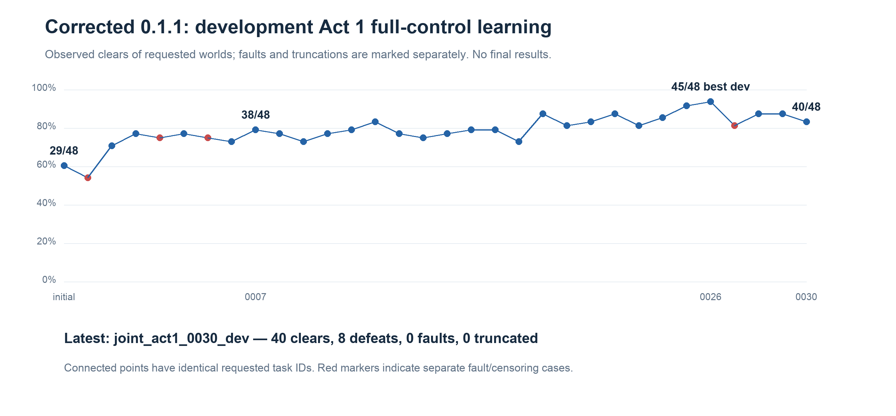

# Non-LLM Slay the Spire — experiment summary

Newest updates first. [Automatic log](nonllm_progress.md) · [Detailed decisions](nonllm_progress_notes.md) · [Plan](nonllm_curriculum_plan.md) · [Agent usage](nonllm_agent_usage.md).
Deadline: **12 October, 06:30 UTC**. All results below are **development results**. The designated final benchmark remains embargoed; [the audit](nonllm_protocol_audit.md) records a separate early smoke-test exception.

## 2026-10-12 05:03 UTC — measured costs extend three-act training

Recent 48-world three-act DEV checks finish in **20 seconds**; the native reference takes **12.3 seconds** with two workers, and 32 later-act fights take **4.5 seconds**. The original final reserve would leave substantial training time unused.

**Decision:** extend three-act training to approximately **06:00 UTC**, then reserve 30 minutes for the unchanged 22 final panels, CLI verification and report. The **06:30 cutoff is unchanged**. This decision precedes all final results; cohorts, rewards, horizons and seeds stay fixed. Full-game competence remains unproven.

## 2026-10-12 04:50 UTC — later-act diagnosis; bridges rejected

Fresh later-act combat checks give **27/32 wins** for the retained combat specialist and **28/32** for both joint checkpoints, with zero faults/truncations. This does not support restoring the old combat head. The earlier specialist composition also had zero three-act victories and reached lower floors than the joint model. Native control had 1/48 victory and one fault.

Two independent 30-second bridges trained OOC decisions with native combat, then tested the same full-control three-act panel:

| Bridge | PPO updates | Training transitions | Victories | Faults |
| --- | ---: | ---: | ---: | ---: |
| Through Act 2 | 22 | 34,438 | 0/48 | 0 |
| Through Act 3 | 37 | 37,068 | 0/48 | 1 |

**Decision:** reject both and resume the main run; preserve all candidates. These short pilots do not establish that the approach cannot work. **353 tests pass**. Final evaluation and selected-model CLI verification remain pending.

## 2026-10-12 04:19 UTC — three-act training exposes the next bottleneck

Act 1 selection finished at **45/48 clears**, with zero faults/truncations. The initial three-act panel ended in **3 Act 1 defeats, 43 Act 2 defeats and 2 Act 3 defeats**, with no victories, faults or truncations. Act 1 competence is retained; full-game competence is not yet demonstrated. Continue three-act PPO.

Matched 48-world development cohort; red markers identify separate fault/censoring cases. [Chart data](assets/nonllm/campaign_panels.csv). Selection retains the best checkpoint, rather than the last. Final horizon is 2,048 decisions versus 4,096 for three-act development; censoring must remain visible.

## 2026-10-12 03:39 UTC — faster training, 42/48 clears

Reuse the exact public features computed during collection. Actions, losses, gradients, optimizer states and updated weights matched exactly in CPU checks; peak numeric cache was about 71 MB.

| Throughput | Earlier chunks | First completed reuse chunk |
| --- | ---: | ---: |
| Accepted transitions/second | 1,157–1,225 | **1,460** |
| PPO feature preparation | 39–40 s | **0.75 s** |

Live policies/worlds differ, so this is observed throughput improvement, not a learning-quality comparison. [Evidence](nonllm_encoding_reuse.md). Supervisor reloads occur between completed jobs; final safeguards bind source, checkpoints, task cohorts and the child’s native build.

## 2026-10-12 03:04 UTC — 38/48 clears and resume repair

Full-control Act 1 selection reached **38/48**, with zero faults/truncations/native-controlled decisions. A resume-cache ordering issue repeated one chunk; its earlier artifacts were archived. The repair normalizes effective option order while retaining settings and input-hash checks.

## 2026-10-12 02:32 UTC — joint learning improves the composed policy

On matched cohorts: shared/composed warm starts clear **7/32 versus 21/32**; long joint training improves **29/48 to 37/48**. The 32- and 48-world panels are different. **Decision:** retain separate phase heads and jointly train them. [Checkpoint format](nonllm_composite_checkpoints.md).

## 2026-10-12 02:12 UTC — OOC selected; corrections rejected

Corrected OOC training improved **12/32 → 29/32**. Matched follow-ups from the same checkpoint:

| Follow-up | Clears / 32 | Faults |
| --- | ---: | ---: |
| Original PPO stopping | 29 | 1 |
| Stop before an over-target KL update | **31** | **0** |
| Twenty scripted-label updates | 19 | 1 |
| Twenty fresh lookahead-label updates | 16 | 0 |

Keep the earlier PPO guard; reject both label corrections. Corrected random/native/heuristic references clear **3/15/22 of 32**, with **1/1/0 faults**. [OOC evidence](nonllm_ooc_corrected.md).

## 2026-10-12 01:12 UTC — native bug repaired and evidence isolated

Automatic combat used an uninitialized character class to index potion/card pools. Old native-auto OOC/lookahead evidence is quarantined. Retain old full-control Ironclad combat evidence only after source and paired-trace checks.

Signed **env-v0.1.1** passed 195 base/307 research tests, bounded smoke and three identical OOC repeats. Preserve the old binary/tag. Fresh banks contain **49,944 Act 1 / 560,620 later-act labels**. [Release evidence](release_v0.1.1.md). Simulator flags detect reported errors, not complete game fidelity.

## 2026-10-12 00:07 UTC — combat specialist selected

Combat17 wins **44/48 Act 1 and 30/32 later-act fights** on the earlier panels. Higher-HP alternatives perform worse with the improved OOC head: **21/32 versus 11/32 and 13/32** clears. Keep combat17; training histories differ. [Coupling evidence](nonllm_health_coupling_corrected.md). Net endpoint HP includes healing and is not cumulative damage.

## 2026-10-11 22:25 UTC — tighter clipping selected

Ten combat controls tested learning rate, clipping, entropy, discount, rewards, HP and scratch learning. Select **clip 0.1, LR 1e-4, gamma 1, entropy 0.01** using expanded later-act evidence. Later-act panels cover 15 development/12 final worlds.

## 2026-10-11 21:28 UTC — laptop recovery

Preserve completed checkpoints after laptop closure. Power reconnected; deadline extended to **06:30 UTC**.

## 2026-10-11 20:50 UTC — architecture and execution choices

Six size/context screens select a **2.3M candidate MLP**, scoring public legal actions. Use **eight persistent CPU simulator workers, CPU rollout inference and MPS updates**. Leading-model collection measured 0.96 s CPU/1.39 s MPS. Replay and dispatch optimizations passed parity checks.

## 2026-10-11 20:08 UTC — scope

Create `codex/nonllm-curriculum` from immutable `env-v0.1.0`, preserving original work. Curriculum: battles → OOC with native combat → full-control Acts 1–3. **Ironclad, ascension 0**; this first window does not claim mastery or Act 4 competence.
