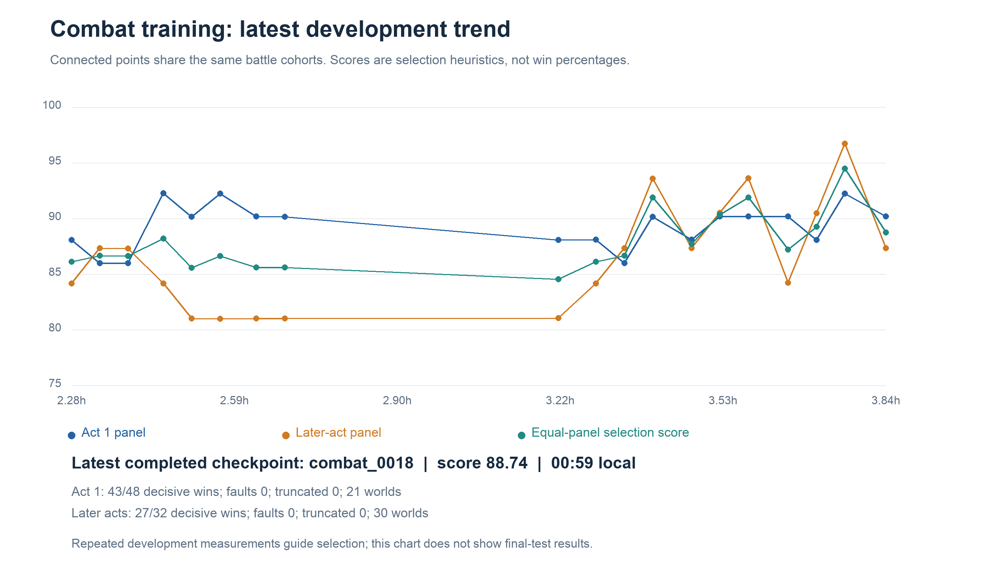

# Non-LLM Slay the Spire — experiment summary

Latest milestones first. [Detailed log](nonllm_progress.md) ·
[Decision/recovery notes](nonllm_progress_notes.md) · [Plan](nonllm_curriculum_plan.md).
Deadline: **12 October, 06:30 UTC**. All results below are development results;
final evaluation remains embargoed. **Native-auto OOC/lookahead evidence before
00:41 UTC is quarantined after the character-class bug described below.**

## 2026-10-12 00:41 UTC — native character-class bug; OOC results quarantined

Repeated OOC evaluations differed across fresh processes. The automatic combat
binding constructed a player with an **uninitialized character class**, then
used it to index class-specific potion/card pools. This can corrupt decisions
or hang. Longer timeouts did not restore repeatability.

**Decision:** preserve the old binary and all results, build a corrected backend
separately, and restart OOC with fresh revision-matched data. Earlier native-auto
OOC and lookahead results are exploratory and must not support competence claims.
The full-control combat policy is retained: its Python-created contexts initialize
Ironclad correctly for this specific defect. Other simulator limitations remain.

The fix initializes the class from the game, initializes automatic combat safely,
and checks UB flags before returning a playout. It will receive a new release
tag only after regression, smoke and reproducibility checks. The deadline stays
**06:30 UTC**; joint full-run training and independent final assessment are still
pending. [Detailed revision notes](nonllm_native_revision.md).

## 2026-10-12 00:07 UTC — combat phase finished; OOC warm starts running

The selected combat specialist is round 17. It matches the native
reference win counts on these development panels; repeated selection and small
world counts still require held-out confirmation.

| Matched development panel | Selected combat | Native reference |
| --- | ---: | ---: |
| Act 1 wins / 48 | 44 | 44 |
| Later-act wins / 32 | 30 | 30 |

Its mean HP cost is **12.48 / 15.72** for Act 1 / later-act fights, versus
**11.15 / 20.56** for the initial short pilot. Higher wins did not uniformly
improve health preservation. No surfaced faults or truncations in these panels.

**Current work:** train the OOC specialist warm start, compare matched native
and lookahead labels, then select among five short PPO settings. Joint full-run
training and independent final evaluation remain pending. A resume-budget bug
repeated one 92-second chunk; the best checkpoint stayed safe, original metrics
were archived separately, and resume handling now preserves recorded budgets and protects selected checkpoints.
Those last supervisor fixes will activate at the next safe restart boundary.

## 2026-10-12 00:00 UTC — development curve and evaluation audit

Combat performance varies between checkpoints; the campaign retains the best
completed development result. This snapshot uses identical cohorts for connected
points and shows selection scores, not success percentages. The latest point
is not necessarily the best checkpoint.

[Chart data](assets/nonllm/combat_development.csv) ·
[Reproduction manifest](assets/nonllm/plot_manifest.json). Horizontal axis: hours
since campaign start. This committed snapshot ends at round 18; regenerate
with `scripts/plot_nonllm_development.py` for current local results.

Independent review found unequal evaluation time caps and selection scores that
could benefit from dropped tasks. Fixes now give evaluation its declared budget
and require complete development cohorts, with faults still reported separately.
All **289 regression tests passed**, with native gates enabled, plus the bounded
rollout smoke. The completed training checkpoint was recovered, and the reviewed
supervisor resumed at **00:05 UTC**. OOC/full-control learning and final assessment
remain pending.

## 2026-10-11 23:53 UTC — combat improvement and the next phase

Later-act training now samples Acts 1, 2 and 3, with corrective native labels
mixed into a fixed rehearsal reservoir. The best development checkpoint has
improved wins and HP cost relative to the selected short pilot:

| Matched development panel | Initial pilot | Current best (round 14) |
| --- | ---: | ---: |
| Act 1 wins / 48 | 41 | 43 |
| Later-act wins / 32 | 29 | 29 |
| Act 1 mean HP cost | 11.15 | 10.75 |
| Later-act mean HP cost | 20.56 | 16.25 |

All four evaluations completed with zero surfaced faults or truncations. These
are repeatedly used selection panels, so improvements need independent final
confirmation. Combat training ends at **00:08:46 UTC**.

**Next:** OOC warm starts compare native and lookahead labels on identical
frontiers. Five matched 90-second PPO controls then compare learning rates and
progress versus sparse rewards before longer OOC training. Integrated learner
control and final held-out evaluation are still pending.

## 2026-10-11 23:25 UTC — health bonuses tested; main combat training continues

The learned combat policy loses materially more HP than native search. Two
matched three-minute reward pilots improved isolated battles, but reduced
full Act 1 clears with the same OOC policy:

| Terminal HP bonus | Battle wins / 80 | Mean battle HP cost | Act 1 clears / 24 |
| --- | ---: | ---: | ---: |
| Reference: none | 70 | 14.91 | 5 |
| 0.25 | 72 | 13.66 | 2 |
| 1.0 | 72 | 14.06 | 3 |

**Decision:** retain the reference under the prespecified selection rule. Keep
both alternatives for later coupling tests; this small panel does not prove
health bonuses are generally harmful. [Study detail](nonllm_health_progress.md).

Training now avoids duplicate inference by reusing the next actor value. Paired
tests preserved trajectories/targets within 7.5e-9 and measured **1.35–1.37×**
faster collection. Direct sticky/live UB checks remove unnecessary replay
deepcopies: **1.613s → 0.915s** over twenty later-act resets. Fault detection,
observations and rewards matched; the native build is unchanged.

## 2026-10-11 22:25 UTC — later-act evidence chooses tighter clipping

Ten combat controls covered learning rate, clipping, entropy, discount,
sparse/potential rewards, HP preservation and scratch learning. Expanded
later-act evidence changed the winner:

| Promoted PPO recipe | Act 1 wins / 64 | Later-act wins / 32 |
| --- | ---: | ---: |
| LR 3e-4 | 59 | 24 |
| Gamma 0.99 | 58 | 26 |
| Clip 0.1 | 55 | 29 |

**Decision:** clip 0.1, LR 1e-4, gamma 1, entropy 0.01, potential shaping.
Matched later-act references: native **30/32**, public heuristic **28/32**,
random **13/32**. The learner's win-rate advantage is uncertain, and its
world-mean HP cost is **11.02 higher than native** (95% paired CI 6.52–16.40).

A CLI flag initially skipped scratch PPO; it was repaired and rerun on the
original matched cohorts. Scratch won **54/64** Act 1 and **20/26** later-act
fights after ninety seconds. It is a useful baseline, not a failed approach.

## 2026-10-11 22:06 UTC — expanded data and fixed comparison cohorts

Added 2,048 native-teacher worlds: **560,620 labels / 24,276 fights**, with
23 flagged worlds quarantined. Act 3 development/final panels now cover
**15/12 worlds**, replacing the earlier single-world limitation. Comparisons
keep fixed cohorts; promoted policies are reevaluated after a cohort change.

Teacher budgets 50/200/1,000 won **42/44/43 of 48** matched fights. Retain
200: mean query time **1.06ms**, versus **4.81ms** at 1,000. Larger search
improved episode-weighted HP, but not world-weighted HP or wins on this panel.

Corrective learning mixes a fixed 20k native rehearsal reservoir with all prior
learner-state labels. OOC teacher comparisons use identical frontiers, initial
weights and time; composite deployment is assessed before final selection.

## 2026-10-11 21:28 UTC — laptop recovery and extended deadline

Six trained architecture checkpoints survived laptop closure. Saved completed
jobs were reused, power was reconnected, and Sid extended the deadline to
**06:30 UTC**. Recovery and failed commands remain in the detailed log.

## 2026-10-11 20:50 UTC — first policies and execution measurements

Initial small models won **42/48** development fights; size/LR selection chose
a large candidate MLP at LR 1e-4: **45/48**, with two seeds each **44/48**.
Use eight persistent CPU simulator workers, CPU rollout inference and MPS
updates. The leading-model warm collection benchmark was **0.96s CPU versus
1.39s MPS**. Phase-routed composite evaluation is **1.57–2.20×** faster.

## 2026-10-11 20:08 UTC — scope and plan

Created `codex/nonllm-curriculum` from immutable `env-v0.1.0`, preserving the
original experiments. Curriculum: isolated combat → OOC with native combat →
full-control Act 1-to-3 traces. Compare shared/specialized policies and reserve
final evaluation time. Inputs are public legal-action candidates and game state;
teacher labels are privileged, and worlds remain in one train/dev/final split.

Known limitation: auto-native combat discards a temporary UB flag. Zero surfaced
hybrid faults cannot certify clean native playouts; explicit full-control faults
are quarantined. The frozen native build has not been silently changed.
