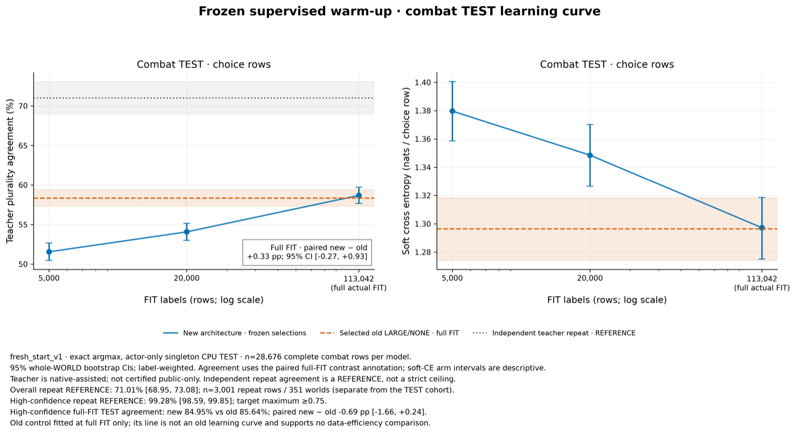
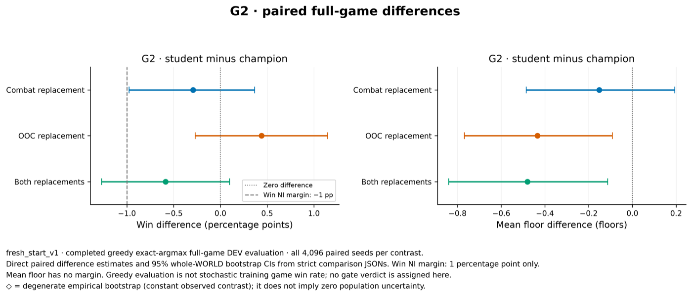

# Fresh start: a structured encoder, warm-started by copying teachers

**Status:** finished 16 October 2026. **Verdict:** the new structured encoder
copied the search teacher no better than the old encoder, and the fresh agent
was not shown to match the champion. Unexpectedly, the *old* encoder, trained
from scratch on the same search-teacher labels, beat the champion's combat by
1.9 points of win rate. That result is exploratory and needs confirming on
fresh worlds.

## Question

1. Does a combat network that sees the game as structured entities (player,
   enemies, hand cards, piles, relics) learn more from the search teacher than
   the old hashed-feature encoder, given the same labels? (Approach:
   [structured entity encoder](../strategies.md#structured-entity-encoder).)
2. Can a fresh agent, built only by copying teachers on environment 0.1.5,
   match the champion, so that it can be the starting point for further
   reinforcement learning? (Approach:
   [distilling the search teacher](../strategies.md#distilling-the-search-teacher).)

## Design

- **Environment:** 0.1.5, the first study on it. Its game-rule fixes change
  play, so the champion was re-measured rather than compared with older
  numbers. Out-of-combat potion actions, new in 0.1.5, were hidden from every
  policy.
- **New encoder:** one token per public game entity, fed to a two-layer
  transformer (width 128, about 0.86 million parameters). Separate networks
  for combat and out-of-combat (OOC) play.
- **Old encoder (control):** the existing candidate-scoring network (about
  2.0 million parameters), whose inputs include hand-made card and potion rule
  features such as block gained and damage dealt. Trained from scratch here; it
  does not inherit the champion's weights.
- **Labels:** the champion played 2,000 new worlds. The search teacher (24
  reseeded samples of 1,000 simulations each, plurality vote) labelled every
  combat decision it reached, giving 159,707 combat labels. The champion's own
  247,614 OOC choices were the OOC labels. Labels were split by whole world into
  fit (113,042 combat labels), validation and test (28,676 combat states from
  363 worlds) sets.
- **Training:** supervised, using the teacher's full vote distribution as the
  combat target and the champion's choice as the OOC target. AdamW, batch 128,
  early stopping on validation loss. The old encoder was tried at two learning
  rates (0.0003 and 0.001, and 0.001 was chosen); the new one only at 0.0003.
- **Evaluation:** agreement with the teacher on the test labels; the Act 2
  boss fight panel (300 starts, each replayed with 8 reseeds); and full games
  on the 0.1.5 DEV worlds, paired against the champion.
- **Decision rules, fixed in advance:**
  - *G1:* the new encoder's test agreement beats the old encoder's, with a 95%
    interval excluding zero, and it is no worse on the Act 2 boss panel.
  - *G2:* the fresh agent (new combat plus new OOC network) is no more than 1
    point of win rate worse than the champion, judged by the lower end of the
    95% interval.
- **Approval:** Sid approved steps A to C on 15 October, with about ten hours
  of laptop compute and a check-in at Gate C before any further training.

## Results

Full games on the 4,096 DEV worlds, each arm paired with the champion on the
same worlds. The last two rows were added after the first four were known.

| Arm | Wins of 4,096 | Win rate difference, points [95% CI] | Mean floor difference [95% CI] |
|---|---:|---:|---:|
| Champion (baseline) | 143 (3.5%) | | (mean floor 35.2) |
| New combat, champion OOC | 131 | −0.3 [−1.0, +0.4] | −0.15 [−0.49, +0.19] |
| Champion combat, new OOC | 161 | +0.4 [−0.3, +1.2] | −0.43 [−0.77, −0.09] |
| New combat, new OOC (the fresh agent) | 119 | −0.6 [−1.3, +0.1] | −0.48 [−0.84, −0.11] |
| Old-encoder combat, champion OOC (exploratory) | 222 (5.4%) | **+1.9 [+1.2, +2.7]** | +0.82 [+0.49, +1.15] |
| Old-encoder combat, new OOC (exploratory) | 196 | +1.3 [+0.5, +2.1] | +0.75 [+0.38, +1.11] |

- **G1 was not met.** Test agreement with the teacher was 58.7% for the new
  encoder against 58.4% for the old: +0.3 points [−0.3, +0.9]. On the Act 2
  boss panel the new encoder lost 1.05 more HP per fight [+0.26, +1.83] and won
  1.6 points fewer fights [−3.5, +0.3].
- **G2 was inconclusive.** The fresh agent's interval crosses both the −1 point
  margin and zero.
- The old-encoder combat model with champion OOC reached Act 3 in 1,078 worlds
  against the champion's 836, and won 222 against 143 (exact paired test
  p = 2.6 × 10⁻⁶).
- Asking the teacher the same question twice with different reseeds gives the
  same answer 71% of the time, so neither student's 58% agreement is near a
  ceiling, but the teacher is itself noisy.
- The new OOC network copied 92% of the champion's real choices, but smithed
  less often at high HP (73% against 78% of opportunities).

## Conclusion

The structured encoder did not help, at least as built here. Both encoders
copied the teacher about equally well on average, yet they played very
differently: the old encoder was clearly better in fights and in full games.
Average agreement with the teacher is therefore a poor guide to playing
strength, and direct game evaluation has to stay in the loop.

The most useful result was not one of the planned ones: distilling the search
teacher into a network with a real training budget (about 4,000 updates on
113,000 labels) produced combat play better than the champion's, which came
from imitation and PPO. Earlier pilots with only 20 to 32 updates had failed.

Not established: why the old encoder plays better. A follow-up
[source comparison](../archive.md) found three plausible reasons that the
study did not separate: the old encoder's hand-made rule features, its larger
size, and its extra learning-rate tuning.

Caveats:
- The old-encoder result was found after looking at the planned results, as
  the best of five arms on reused DEV worlds. Its p-value survives that, but
  it has not been tested on fresh worlds.
- Each model was trained once, with one random seed.
- The champion was trained on environment 0.1.4 or earlier, so part of the gain
  may come from adapting to 0.1.5's changed game rules rather than from
  distillation as such.
- The labels come from states the champion reached, not states the students
  reach themselves.
- The search teacher uses simulator copies, so it is not limited to public
  information.
- No Act 2 or Act 3 event fights appeared in the label data.

## Next

- Confirm old-encoder combat with champion OOC against the champion on 8,192
  fresh confirmation worlds, before promoting it. Proposed, not yet run.
- The [representation controls](2026-10-16-representation-controls.md)
  experiment tests whether the rule features, network size or learning rate
  explain the gap between the encoders.
- The planned step D, not yet approved, would continue from the distilled
  combat model: label the states the student itself visits with the search
  teacher and retrain (expert iteration), and run OOC PPO.

## Log

- 15 Oct: plan approved by Sid; environment 0.1.5 adopted.
- 16 Oct: all planned results in; G1 not met, G2 inconclusive.
- 16 Oct: the two old-encoder arms were added and their settings frozen
  before they ran; they are reported as exploratory.
- 16 Oct: a follow-up compared the two encoders' sources and settings and found
  the differences listed under Conclusion; no new training.

Code: `src/sts_rl/fresh_*.py` and `scripts/rl/fresh_*.py` (written before
the experiment-folder convention), at commit `ee115ba`. Data: run
`fresh_start_20261015` in the `nonllm-fresh-start` worktree (local).
