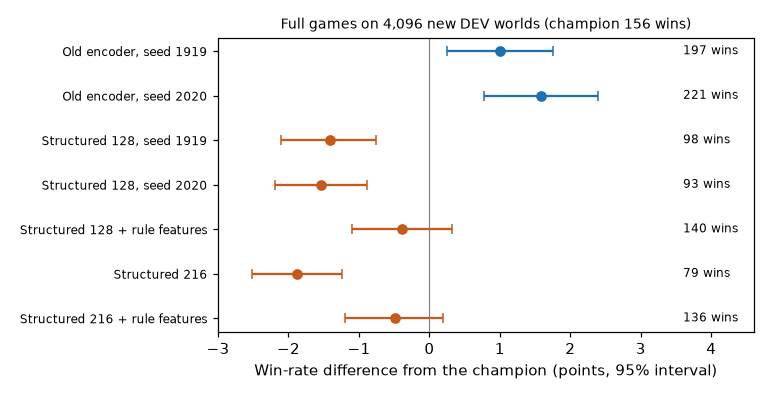
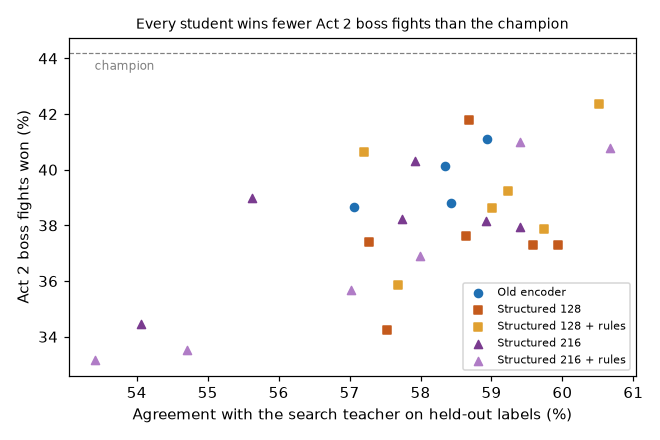

# Representation controls: why did the structured encoder lose?

**Status:** finished 20 October 2026. **Verdict:** the old encoder's lead over
the structured encoder is real and repeats at a second training seed (+2.4
and +3.1 points of full-game win rate); the old encoder's hand-made rule
features explain part of it, network width explains none of it, and the rest
is unexplained.

## Question

In the [fresh-start study](2026-10-15-fresh-start.md), the structured entity
encoder copied the search teacher as well as the old encoder but played worse.
It also differed from the old encoder in three ways at once: it lacked the old
encoder's hand-made card and potion rule features, it was smaller (0.86 against
2.0 million parameters), and it had less learning-rate tuning. Which of these
explains the gap, and does the gap repeat with a different training seed?
(Approach: [structured entity encoder](../strategies.md#structured-entity-encoder).)

## Design

- **Factorial comparison,** run at two training seeds (1919 and 2020):
  rule features on or off (off is the original structured model), width 128
  (original) or 216 (matching the old encoder's parameter count within 5%),
  learning rate 0.0003 or 0.001. Old-encoder controls at both learning rates
  and seeds.
- **Extra rule, fixed in advance:** if the lower learning rate won on
  validation for every wide model, also fit learning rate 0.0001 for every
  structured model. It did, so 26 new models were fitted in all.
- **Training data:** the fresh-start study's combat labels, unchanged.
  Checkpoints and learning rates are chosen on validation loss only.
- **Evaluation:** teacher agreement on the fresh-start test labels; a new
  fight panel from 1,024 unused worlds (400 Act 2 boss fights, primary, plus
  100 Act 1 boss and 100 Act 2 hallway fights, each replayed with 8 reseeds);
  and full games for eight arms, fixed in advance, on 4,096 new DEV worlds
  with champion out-of-combat play.
- **Primary measures:** the effect of features, width and learning rate on HP
  lost in Act 2 boss fights, each averaged over the other two factors and
  reported per seed; in full games, the paired win difference between the old
  encoder and the original structured model at each seed. An effect counts as
  replicated only if both seeds agree in direction and both 95% intervals
  exclude zero. Intervals bootstrap whole source worlds (10,000 resamples).
- **Approval:** Sid approved this supervised diagnosis on 16 October. No
  further RL, no promotion, and no use of the confirmation worlds.

## Results

**Full games: the old encoder beats the original structured model at both
seeds.** Paired on the same 4,096 worlds, with champion out-of-combat play:

| Seed | Old encoder | Structured, width 128 | Difference, points [95% CI] | Exact paired p |
|---|---:|---:|---:|---:|
| 1919 | 197 | 98 | **+2.4 [+1.7, +3.1]** | 5 × 10⁻¹² |
| 2020 | 221 | 93 | **+3.1 [+2.4, +3.9]** | 2 × 10⁻¹⁶ |

All arms against the champion (156 wins, 3.8%): old encoder +1.0 [+0.2, +1.8]
(seed 1919) and +1.6 [+0.8, +2.4] (seed 2020); structured 128 −1.4 [−2.1,
−0.8] and −1.5 [−2.2, −0.9]; with rule features −0.4 [−1.1, +0.3]; width 216
−1.9 [−2.5, −1.3]; width 216 with rule features −0.5 [−1.2, +0.2]. Among the
seed-1919 structured arms, rule features added +1.0 [+0.4, +1.6] at width 128
and +1.4 [+0.8, +2.0] at width 216; width 216 against 128 gave −0.5 [−1.0,
+0.1] without features and −0.1 [−0.8, +0.6] with them; the best structured
arm still trailed the old encoder by −1.4 [−2.2, −0.7].

**Fight panel, Act 2 boss HP lost (primary main effects):**

| Factor | Seed 1919 | Seed 2020 | Mean of seeds | Status |
|---|---:|---:|---:|---|
| Rule features on − off | +0.33 [+0.07, +0.60] | −0.52 [−0.78, −0.25] | −0.09 [−0.28, +0.09] | Inconclusive: seeds disagree |
| Width 216 − 128 | +1.12 [+0.72, +1.53] | +1.56 [+1.15, +1.98] | +1.34 [+1.02, +1.68] | Replicated: wider loses more HP |
| Learning rate 0.001 − 0.0003 | +0.93 [+0.61, +1.26] | +0.94 [+0.57, +1.31] | +0.94 [+0.68, +1.20] | Replicated: higher rate loses more HP |

Positive means more HP lost (worse); the champion loses 58.7 HP per Act 2
boss fight and wins 44.2% of them. The width and learning-rate effects are
carried by one combination: width 216 at learning rate 0.001, which also had
the worst validation loss of any model (1.33 to 1.35 against 1.28 to 1.32).
At the lower rate with rule features, width 216 was *better* at both seeds
(−1.07 and −0.96 HP; +2.9 and +2.4 points of boss fights won). So "wide
models need the lower learning rate", not "width hurts". Boss fight wins
gave the same picture with the sign reversed. Feature effects at fixed width
and rate pointed both ways.

- **Did the original gap repeat on new fights?** Old encoder minus the
  original structured recipe (width 128, rate 0.0003): −2.04 HP [−2.76, −1.34]
  at seed 2020, −0.55 [−1.22, +0.08] at seed 1919. It repeated at one seed.
- **Every one of the 28 students won fewer Act 2 boss fights than the
  champion** (33.2% to 42.3% against 44.2%), on the champion's own boss
  states. Yet both old-encoder students beat the champion in full games: they
  reach the Act 3 boss in 1,098 and 1,186 worlds against its 810, with more
  HP at the Act 2 boss. The gain is in hallway fights (Act 2 hallway HP lost
  8.6 to 8.8 against 11.1), not boss fights.
- **Agreement with the teacher** ranged from 53.4% to 60.7% (old encoder 57.1%
  to 58.9%). Across the 28 students it tracks Act 2 boss fight wins
  (correlation 0.66), but it does not rank full-game play: the highest-agreement
  structured model (60.7%) won 136 games against the old encoder's 197.
- **Learning rate 0.0001** (secondary extension, 8 structured fits) had worse
  validation loss than 0.0003 in all 8 and lost 59.4 to 61.5 HP per Act 2 boss
  fight.

## Conclusion

Established, by the study's own rule: with equal learning-rate tuning, the
old encoder plays full games better than the original structured encoder,
at both training seeds, by 2.4 and 3.1 points. The original gap was not a
fluke of one training run.

Partly explained: adding the old encoder's rule features to the structured
model recovered about a point of win rate in full games at seed 1919 (+1.0
and +1.4), though not consistently on the boss panel. Not explained by size:
matching the old encoder's parameter count did nothing in games. About 1.4
points of the gap remain. The likeliest remaining causes, none tested here,
are the old encoder's state features (incoming and unblocked damage, the
hashed summary of piles, powers and relics), which the controlled model does
not receive, and the different architecture.

The more useful lesson is about measurement. The Act 2 boss panel, built from
the champion's own states, did not predict full-game results: every student
was worse than the champion there, yet the best students beat it in full
games through hallway fights. Boss fight win rate is a better panel measure
than HP lost, and hallway panels deserve equal weight.

Caveats:
- Game arms are at seed 1919 only, except the old-against-structured pair.
- The panel samples the champion's states, not each student's.
- Rule features were added only to action inputs; the old encoder's state
  features were not tested.
- One old-encoder seed-2020 world was cut at the 4,096-decision limit (the
  agent repeated the first menu option for hundreds of decisions); it counts
  as a loss, by Sid's decision. The champion also lost that world.
- DEV worlds 91,001,000,000 onwards are now used; the confirmation range stays
  closed.

## Next

- Keep the old encoder for combat; set the structured encoder aside. Further
  encoder diagnosis is lower value than deck-building, which the
  [19 October brainstorm](../brainstorms/2026-10-19-brainstorming.md) found to
  be the main bottleneck.
- Before promoting either old-encoder student, confirm one, chosen in
  advance, on the reserved confirmation worlds.
- Use Act 2 boss fight win rate and hallway HP lost as the panel measures.

## Log

- 16 Oct: design fixed and approved; a new fight bank was collected before
  any fitting.
- 16 Oct: the main fits finished; the lower-learning-rate extension was
  triggered and run.
- 17 Oct: collection paused on battery, then stopped at a safety deadline
  the study had set itself.
- 19 Oct: restarted with no deadline at Sid's request. A battery pause caused
  six simulator timeouts in one panel, which was re-run successfully.
- 19 Oct: Sid moved the work from Codex to Claude during the game arms.
  Claude relaunched the remaining seven arms with the study's own commands,
  on seven lanes instead of eight; the interrupted seed-1919 old-encoder arm
  was re-run in full into a new folder.
- 19 Oct: another four-hour battery pause made one world time out in each of
  two shards; both shards were re-run whole, and their other 1,022 worlds
  replayed identically.
- 19 Oct: one old-encoder seed-2020 world was cut at the decision limit; Sid
  decided to count it as a loss.
- 20 Oct: analysis run with the study's own statistics code.

Code: `src/sts_rl/controlled_*.py`, `src/sts_rl/representation_controls.py`
and `scripts/rl/controlled_*.py` at commit `1636034`; game-arm completion,
analysis and figures in `experiments/2026-10-16-representation-controls/` at
commit `fc506cd`. Data: run `representation_controls_20261016`
(local), analysis in its `analysis_20261020/report.json`.
