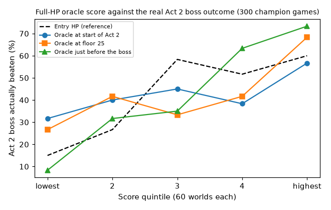

# Deck-strength oracle: can simulated boss fights measure a deck?

**Status:** finished 20 October 2026. **Verdict:** yes: a full-HP boss fight
simulated 16 times just before the Act 2 boss predicts whether the champion
really beats it far better than its HP does, and is nearly independent of
HP, so decks differ a lot in strength after all.

## Question

The champion loses most games at the Act 2 boss, and its decks look the same
whether it wins that fight or not ([19 October brainstorm](../brainstorms/2026-10-19-brainstorming.md)).
Full-game reward therefore says little about deck-building. A cheaper signal:
copy the game at any out-of-combat moment, start this act's boss fight with
the current deck, relics and potions, and play it many times with different
random seeds. If that "oracle" score measures deck strength, it could teach
deck-building directly or serve as a dense reward.

This feasibility spike asks: does the oracle score, measured before the boss,
predict whether the champion actually beats the Act 2 boss, beyond the HP it
enters with? And how noisy is it, so what would it cost per decision?

## Design

- **Games:** the champion's recorded games on the second DEV worlds
  (environment 0.1.5), replayed exactly from their action records; the first
  300 worlds that reach the Act 2 boss, in seed order.
- **Three moments per game:** the first out-of-combat decision of Act 2, the
  first at floor 25 or later, and the last before the Act 2 boss fight.
- **Oracle:** from a copy of the game at that moment, enter the act's boss
  fight and play it with the champion's combat network, 16 times with
  different battle seeds. Two variants: HP set to maximum (deck strength
  alone) and actual HP. Scores: share of fights won, HP lost, and boss damage
  (share of the boss's HP removed; 1 for a win), which still varies when the
  deck is too weak to win.
- **Measures:** how well each score predicts the real Act 2 boss outcome
  (area under the ROC curve, AUC, and cross-validated log loss of a logistic
  model with entry HP alone against entry HP plus the oracle); the score's
  split-half reliability (8 seeds against the other 8); cost in seconds.
- **Decision rule, fixed in advance:** worth building on if the full-HP oracle
  at the last decision before the boss adds predictive power beyond entry HP
  (cross-validated log loss improves and the AUC of the combined model rises
  by at least 0.03) and its split-half reliability is at least 0.5. The
  score for this rule is boss damage, the mean over the 16 fights.
- **Compute:** a few laptop cores for under an hour, alongside the Codex
  throughput work.
- **Approval:** Sid approved the spike on 20 October as part of the plan in
  the brainstorm.

## Results

**The oracle passes its decision rule.** 300 champion games (all replays
reproduced the recorded games exactly; no faults); 42% beat the Act 2 boss.

| Predictor of the real Act 2 boss outcome | AUC alone | With entry HP (cross-validated AUC) | Split-half reliability |
|---|---:|---:|---:|
| Entry HP (fraction and absolute) | 0.68 | 0.64 (entry HP only) | |
| Oracle at the start of Act 2 (full HP, boss damage) | 0.60 | 0.71 | 0.94 |
| Oracle at floor 25 | 0.65 | 0.73 | 0.95 |
| **Oracle just before the boss** | **0.78** | **0.83** | **0.91** |

For the primary score, adding the oracle to entry HP lowers cross-validated
log loss by 0.127 (95% bootstrap interval 0.085 to 0.182) and raises AUC by
0.19. Its correlation with entry HP is 0.04, so it measures something HP does
not: the deck, relics and potions. Win share and HP lost gave the same
picture as boss damage.

- Across quintiles of the just-before-boss oracle, the real pass rate runs
  8%, 32%, 35%, 63%, 73%; across entry-HP quintiles, 15%, 27%, 58%, 52%, 60%.
- At full HP the champion's own decks win the simulated boss fight anywhere
  from never to always: mean 61% of fights, standard deviation 31 points
  across worlds. At the start of Act 2 (18 or 19 cards) they win 17%.
- Cost: about 0.07 s per simulated fight on one core, so 16 fights cost about
  1.1 s per evaluated state.

## Conclusion

Deck strength varies widely between the champion's games, and a cheap,
reliable simulation can measure it. This corrects the brainstorm's reading
that passing and failing decks look the same: they look the same in simple
counts (size, Strikes, upgrades, powers), but not in how they fight the boss.

Not yet established: whether the oracle can tell *choices* apart. The test
here scores decks as they stand; a teacher must score each option at a card
reward, shop or rest site, where differences are smaller. Earlier moments
predict less (AUC 0.60 at the start of Act 2), as expected for a measure
that judges today's deck rather than the deck it will become.

Caveats:
- The just-before-boss oracle replays the same boss with the same deck,
  relics and potions as the real fight, so part of its predictive power is by
  construction. Its independence from HP and its spread across worlds are
  what show it measures the deck.
- The fights are played by the champion's combat network, so the score is
  deck strength for this player; a deck it plays badly scores low.
- The oracle copies the simulator, so it is a teacher's tool, not something
  a policy can use at play time.
- One policy, 300 worlds, one act.

## Next

1. Test whether the oracle separates options: at card rewards, shops, rest
   sites and removals in Act 2, score every option, and measure how often
   option differences exceed the noise and how often the champion's choice
   is the oracle's best.
2. If it does, distil oracle-preferred choices into the out-of-combat network
   and test in full games, as was done for smithing.
3. Extend to the Act 1 and Act 3 bosses.

## Log

- 20 Oct: a two-world smoke test showed early-Act-2 decks never win the boss,
  so the boss-damage score and the mid-act moment were added before the
  full run.
- 20 Oct: boss damage chosen as the decision rule's score before any full-run
  results were seen.
- 20 Oct: full run finished in 9 minutes on 4 cores; decision rule met.

Code: `experiments/2026-10-20-deck-oracle/` at commit COMMIT. Data: run
`deck_oracle_20261020` (local), analysis in its `analysis.json`.
