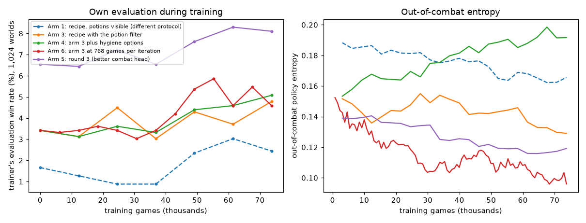

# Large-batch out-of-combat PPO: was gradient noise the limit?

**Status:** finished 21 October 2026. **Verdict:** batch size was not the
limit (768 and 3,072 games per iteration gave no clear difference at equal
games); continuing out-of-combat PPO, measured correctly, improved every
arm, and round 3 on the better combat head reached 9.6% on fresh worlds.

## Question

The champion's out-of-combat PPO ran at 768 games per iteration with
half-batch gradient cosines of 0.09 to 0.21, and adjacent checkpoints swung
between 35 and 57 wins on the same worlds: the 13 October diagnosis was
that updates were a noise-driven random walk and that training had
plateaued. Collection is now 3.2 times faster, so four times the batch
costs what the old batch did. Does a larger batch improve the champion, and
do the PPO hygiene options add anything? (Approach:
[out-of-combat PPO](../strategies.md).)

## Design

All arms freeze the combat head (played greedily), use macro credit,
Monte-Carlo returns (lambda 1), weight decay 0 (the lineage had a silent
0.01), learning rate 0.0003, 3 epochs, minibatch 4,096, clip 0.2, KL guard
0.05, training seed 0, and 12 in-process collectors of 32 games. Each arm
trains on 73,728 games.

| Arm | Start | Batch | Other settings |
|---|---|---|---|
| 1, recipe (`recipe`) | previous champion | 24 × 3,072 | out-of-combat potion actions visible |
| 2, hygiene | | | cancelled after the potion-protocol finding; replaced by arm 4 |
| 3, recipe with the potion filter (`recipe_hidden`) | previous champion | 24 × 3,072 | `--hide-ooc-potions` in collection and evaluation |
| 4, hygiene with the filter (`hygiene_hidden`) | previous champion | 24 × 3,072 | arm 3 plus a detached critic, normalised value targets and an entropy bonus of 0.01 on strategic menus |
| 5, round 3 (`round3_student`) | new champion with the old-encoder combat student spliced in | 24 × 3,072 | as arm 3 |
| 6, batch-size control (`small_hidden`) | previous champion | 96 × 768 | as arm 3 |

- **Pairings:** arm 3 against arm 1 isolates the filter in training; arm 4
  against arm 3 the hygiene options; arm 6 against arm 3 the batch size.
- **Evaluation:** each arm's final checkpoint, and its best by the trainer's
  own evaluation, with `fast_eval.py` under the study protocol on the 4,096
  second-DEV worlds, paired with the arm's start; the final checkpoint also
  on 4,096 fresh worlds from 94,000,000,000 (never used before 20 October).
- **Decision rule, fixed in advance:** an arm is *Better* if its final
  checkpoint wins more than its start with exact McNemar p < 0.05; a
  best-by-evaluation checkpoint is a selection and only exploratory.
- **Approval:** Sid, 20 October: arm 1 ("bump 4a up to being kicked off
  now"), arms 3 and 4 ("queue … with --hide-ooc-potions after lb-recipe
  finishes"), arms 5 and 6 ("run round 3 and the batch-size control
  overnight as queued"). Arm 1's iteration 24 was promoted to champion on
  20 October at 16:05, before arms 3 to 6 ran.

## Results

**Every arm beat its start on both world sets.** Final checkpoints, study
protocol, wins of 4,096, paired with the start:

| Arm | Second DEV: start → arm (p) | Fresh worlds: start → arm (p) | Fresh worlds, mean floor difference |
|---|---|---|---|
| 1, recipe | 156 → 276 (< 0.001) | 152 → 232 (< 0.001) | +1.24 [+0.91, +1.58] |
| 3, recipe with filter | 156 → 208 (0.001) | 152 → 197 (0.006) | +1.13 [+0.81, +1.45] |
| 4, hygiene with filter | 156 → 256 (< 0.001) | 152 → 228 (< 0.001) | +1.05 [+0.73, +1.38] |
| 6, batch-size control | 156 → 212 (0.001) | 152 → 190 (0.027) | +0.88 [+0.53, +1.24] |
| 5, round 3 | 316 → 413 (< 0.001) | 315 → 394 (< 0.001) | +1.18 [+0.86, +1.50] |

**Between arms, only the hygiene options showed a clear effect, and only
on the DEV worlds:**

| Comparison | Second DEV wins (p); floor difference | Fresh-world wins (p); floor difference |
|---|---|---|
| Batch size: arm 6 vs arm 3 | 212 vs 208 (0.87); +0.00 [−0.36, +0.36] | 190 vs 197 (0.73); −0.25 [−0.61, +0.10] |
| Hygiene: arm 4 vs arm 3 | 256 vs 208 (0.009); +0.21 [−0.12, +0.55] | 228 vs 197 (0.088); −0.08 [−0.43, +0.26] |
| Filter in training: arm 3 vs arm 1 | 208 vs 276 (< 0.001); −0.13 [−0.48, +0.22] | 197 vs 232 (0.058); −0.11 [−0.45, +0.23] |
| Arm 4 vs arm 1 | 256 vs 276 (0.34); +0.08 [−0.27, +0.42] | 228 vs 232 (0.87); −0.19 [−0.54, +0.16] |
| Round 3 vs the harvest stack (its start plus the Demon Form rule) | 413 vs 333 (< 0.001); +0.52 [+0.20, +0.85] | 394 vs 346 (0.033); +1.03 [+0.70, +1.35] |
| Round 3 vs arm 1 (the new champion) | 413 vs 276 (< 0.001); +1.82 [+1.45, +2.19] | 394 vs 232 (< 0.001); +2.12 [+1.76, +2.49] |

- **Monitoring:** arm 1's own evaluation, with potions visible, showed 9 to
  31 wins of 1,024 and would have called the run a failure at iteration
  12; with the filter, the trainer's evaluation tracked the study protocol.
- **Entropy** fell in every arm except arm 4, where the entropy bonus
  raised it from 0.15 to 0.19; arm 6, with four times as many updates,
  fell furthest (0.15 to 0.10).
- **Smithing** moved more than any other habit: arm 1 fell to 0.20 then rose
  to 0.41; arm 6 fell to 0.09 by iteration 16 and recovered to 0.26; round
  3 fell steadily from 0.49 to 0.38. Card skip rates stayed at 0.02 to 0.03.
- **Best-by-evaluation checkpoints** (selections): arm 1 iteration 20, 224
  wins; round 3 iteration 20, 403; arm 6 iteration 72, 222; for arms 3 and
  4 the final checkpoint was best.
- **Harvest on the new champion** (second DEV, paired with its 276): plus
  the Demon Form rule 292 (p = 0.076), plus the old-encoder combat student
  316 (p = 0.050), plus both 333 (p = 0.006); both confirmed on the fresh
  worlds at 346 against 232.
- **The potion habit survived arm 1:** with out-of-combat potion actions
  visible, the new champion still discarded 588 potions in 64 games (the
  previous champion 565), and wins 143 of 4,096 against 70 on that
  protocol.
- **Run facts:** no faults or collector restarts in any arm; about 6
  minutes per 3,072-game iteration and 1.3 minutes per 768-game iteration,
  so arm 6 took 2 hours 12 minutes against arm 4's 2 hours 25 minutes;
  half-batch cosines stayed between −0.55 and +0.71 with no trend.

## Conclusion

- **The plateau was a measurement artefact, not a batch-size limit.** At
  equal games, four times the batch gave no clear difference (arm 6 against
  arm 3), yet every arm improved substantially over its start. The earlier
  "plateau" at 768 games was read from the potions-visible evaluation,
  which understated arm 1's gain by an order of magnitude.
- **Continued out-of-combat PPO is the strongest lever we have.** Five arms
  gained +0.9 to +2.0 points of wins and about +1 mean floor on fresh
  worlds; on the better combat head the gain was largest (round 3, 7.7% to
  9.6%), and round 3 beats the Demon Form overlay without the rule.
- **The hygiene options are worth keeping** under the potion filter: more
  wins on DEV (p = 0.009), the same direction on fresh worlds, and an
  entropy bonus that stops the policy saturating further.
- **Hiding potions during training does not help training;** it is a
  monitoring and deployment fix.

Caveats:
- One training run per arm; checkpoints of one run differ by up to about 50
  wins, so arm-to-arm gaps below that are uncertain.
- The fresh worlds from 94,000,000,000 now carry many comparisons from this
  study. Nothing was selected on them, but they are no longer unused.
- Arm 1 changed lambda and weight decay as well as the batch; the batch-size
  control isolates batch only under the filter.
- Comparisons against the new champion and the harvest stack were added
  after seeing round 3's result.

## Next

1. Sid to decide whether round 3's final checkpoint becomes the champion,
   perhaps after a check on a further unused world range.
2. Test the Demon Form rule on top of round 3; distil it if it still adds.
3. Round 4: continue from round 3 with the potion filter and the hygiene
   options, adding exploration tracking (per-menu entropy, rare-action
   sampling).
4. Use 768 or 3,072 games per iteration as convenient; batch size is not
   the lever.

## Log

- 21 Oct, 06:49: all arms evaluated; the batch-size control shows no clear
  difference from arm 3.
- 21 Oct, 04:37: round 3 wins 394 of 4,096 fresh worlds, the best pure
  policy so far.
- 20 Oct, 23:00: Sid approved round 3 and the batch-size control overnight.
- 20 Oct, 20:10: arm 3 paused 2 hours 20 minutes on battery; no data lost.
- 20 Oct, 16:05: Sid promoted arm 1's iteration 24 to champion.
- 20 Oct, 15:49: confirmation moved to the unused worlds from
  94,000,000,000: the reserved set from 91,200,000,000 is embargoed in code
  and Sid kept it unopened, and the 93,000,000,000 namespace is reserved for
  probe states (partial output under `confirm93/` is void).
- 20 Oct, 12:16: the hygiene arm cancelled after the potion-protocol
  finding; arms 3 and 4 queued with the filter at 13:25.

Code: `scripts/rl/train_ooc.py` (library `src/sts_rl/ooc_trainer.py`) from
the frozen checkout at `ws/nonllm` 8aca4e4 for arms 3 to 6; comparisons with
`experiments/2026-10-20-boss-rares/compare_arms.py`; figure
`experiments/2026-10-20-large-batch-ppo/plot_arms.py` at commit 133b5bd.
Data: run `large_batch_20261020` (local, worktree `nonllm-large-batch`).
