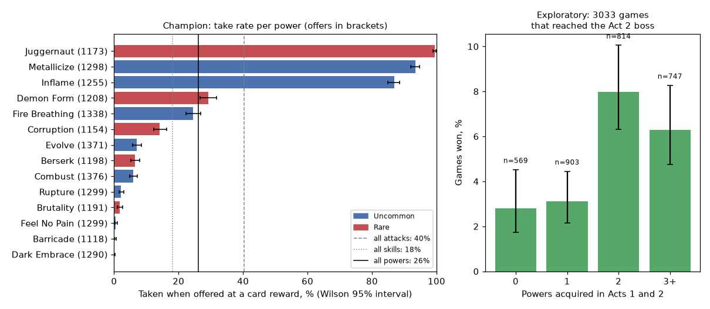

# Power picks: why do the champion's decks hold so few powers?

**Status:** finished 20 October 2026. **Verdict:** powers are offered often
and, as a class, taken as often as other cards; the champion's power count
is set by whether three favourite powers happen to be offered, because it
firmly rejects the other eleven, and it skips most boss card rewards.

## Question

The deck oracle found that power cards go with stronger decks (correlation
+0.31 between the number of powers and the oracle's before-boss score;
Demon Form, Juggernaut and Inflame each raise it), yet the champion's decks
at the Act 2 boss average 1.6 powers and only 8% hold Demon Form. Is that
because powers are rarely offered, because the champion declines them when
they are offered (a card-reward habit), or because its picks are close calls
that fall either way? The answer decides whether a cheap intervention
(a rule overlay or a targeted distillation) is worth testing before building
a learned deck-value model. (Approach:
[deck-strength oracle](../strategies.md#deck-strength-oracle).)

## Design

- **Data:** the champion's 4,096 recorded games on the second DEV worlds
  (environment 0.1.5, the representation-controls study), replayed to every
  card-reward screen and every shop. For each card reward: the options with
  their type and rarity, the deck, HP and gold at the time, the champion's
  choice (a card, "skip card reward", or proceeding without a card), and the
  champion's probability for every option at the moment it chose. For each
  shop: the cards offered with prices, and what was bought.
- **Measures:** the share of offered options that are powers, by act; the
  take rate of each option type and rarity when offered, with Wilson 95%
  intervals; per-card take rates; the probability the champion assigned to
  powers it declined (a near miss or a firm rejection); powers per game
  offered, taken, bought and in the final deck; the Act 2 oracle's per-card
  values from the option test for comparison.
- **Reading the result, fixed in advance:** a *habit* if the take rate of
  powers is clearly below that of other cards of the same rarity (intervals
  not overlapping) and the declined powers mostly carry probability under
  0.01; an *offer-rate effect* if powers are a small share of options and
  are taken about as often as other cards; *near misses* if declined powers
  often carry probability above 0.3, which would make a mild temperature or
  overlay enough to change them.
- **Compute:** about 3 minutes on 6 laptop cores for the replay.
- **Evidence level:** exploratory (a description of the champion's play, not
  a comparison between policies).
- **Approval:** Sid, 20 October 2026.

## Results

**Powers are not under-picked as a class.** 4,096 games, 59,532 card-reward
decisions (14.5 per game). Take rate when offered, by type and rarity:

| Offered card | Common | Uncommon | Rare | All |
|---|---|---|---|---|
| Attack | 47.5% [47.1, 47.9] (64,818) | 21.7% [21.0, 22.3] (17,695) | 19.7% [18.8, 20.7] (6,223) | 40.4% (88,736) |
| Skill | 22.8% [22.3, 23.3] (27,845) | 16.8% [16.3, 17.2] (27,870) | 4.6% [4.1, 5.2] (6,484) | 18.2% (62,199) |
| Power | none exist | 26.2% [25.5, 27.0] (12,787) | 26.2% [25.2, 27.2] (7,406) | 26.2% (20,193) |

- **Offers are plentiful.** Powers are 11.8% of the options offered at card
  rewards, 29.1% [28.7, 29.5] of screens offer at least one, and a game sees
  4.2 such screens. Shops offer a power in 86% of visits.
- **The choice is per card, and firm** (figure 1). Juggernaut (99.5% of
  1,173 offers), Metallicize (93.5% of 1,298) and Inflame (86.9% of 1,255)
  are almost always taken. Demon Form is taken 29.1% [26.6, 31.8] of 1,208
  offers, Fire Breathing 24.5%, Corruption 14.2%, and the other eight powers
  0% to 7%. When the champion declines a power, its probability for it has
  median 0.00007; 80% of declined powers sit below 0.01 and 2.6% above 0.3.
- **So the power count is mostly luck.** One of the three favourites is
  offered at a reward or shop in 78.0% [76.7, 79.2] of games and ends in the
  final deck in 72.0%. A game takes 1.3 powers at rewards and buys 0.4; the
  final deck (25.8 cards) holds 1.9 powers, and 18.8% of games end with none.
- **Boss card rewards are mostly skipped.** At the 5,066 screens whose cards
  are all rare (4,895 of them at boss rooms), the champion skips the card in
  71.7% [70.2, 73.1] of Act 1 screens (3,704) and 58.0% [55.3, 60.6] of Act 2
  screens (1,326), against 6.8% elsewhere. These are not near misses either:
  when it skips, the best card's probability has median 0.0007 and exceeds
  0.3 in 4.0%. At those screens it takes Juggernaut 100% of the time (865
  offers), Immolate 37%, Demon Form 11%, Reaper 9%, Feed 7%, Corruption 5%,
  and every other rare 2% or less. Demon Form's take rate rises from 23.9%
  in Act 1 to 38.6% in Act 2 and 88% in Act 3 (26 offers); when declined, the
  champion skips the reward 70% of the time and takes Juggernaut 14%.
- **Exploratory, confounded:** among the 3,033 games that reached the Act 2
  boss, games that acquired no power in Acts 1 and 2 won 2.8% [1.7, 4.5]
  (569), one power 3.1% (903), two 8.0% [6.3, 10.1] (814), three or more
  6.3% (747). Acquiring a power mostly means being offered a favourite, so
  this does not separate the cards' value from the luck of the offers.
- The Act 2 option test scored only 38 power offers: mean value against
  skipping +0.001 boss damage (attacks +0.010, skills −0.005), too few to
  rank powers.

*Figure 1. Left: how often the champion takes each power when offered at a
card reward (offers in brackets; the lines mark the overall take rates of
attacks, skills and powers). Right: the exploratory win-rate split by powers
acquired in Acts 1 and 2.*

## Conclusion

Neither an offer-rate effect nor a habit against powers explains the low
power count. The champion treats three powers as must-takes and nearly all
others, including Demon Form, as near-worthless, with no middle ground, so
its power count is decided by which cards the game offers. The clearest
pattern is wider than powers: at boss card rewards, where rares are offered,
it skips the card about two thirds of the time and takes only Juggernaut
reliably. Whether those skips are wise for a combat policy that may not play
the rares well is not established; the oracle cannot resolve single cards,
and the win-rate split by powers is confounded by offer luck.

Caveats:
- One policy, described, not compared; a take rate depends on what else was
  on the screen.
- Probabilities are the out-of-combat head's softmax at the decision, not a
  measure of value.
- Final-deck power counts use the type labels seen on offers; 2,621
  final-deck cards (curses and event cards) had no label and were ignored.
- The exploratory win-rate split is confounded by offer luck and by game
  length.

## Next

- Test the skips directly: a paired comparison on the 4,096 DEV worlds of the
  champion against the champion with a rule that takes a chosen rare (Demon
  Form, or the oracle-preferred card) at boss rewards instead of skipping;
  about 21% of games meet an Act 1 Demon Form offer. This is the existing
  overlay-then-distil loop and costs about 15 minutes of evaluation.
- The deck-value network remains the general route to valuing single cards.

## Log

- 20 Oct: replay of the 4,096 champion games, 3 minutes on 6 cores; the
  boss-reward skipping was found while reading the per-card table, after the
  pre-specified measures.

Code: `experiments/2026-10-20-power-picks/`. Data: run `power_picks_20261020`
(local).
