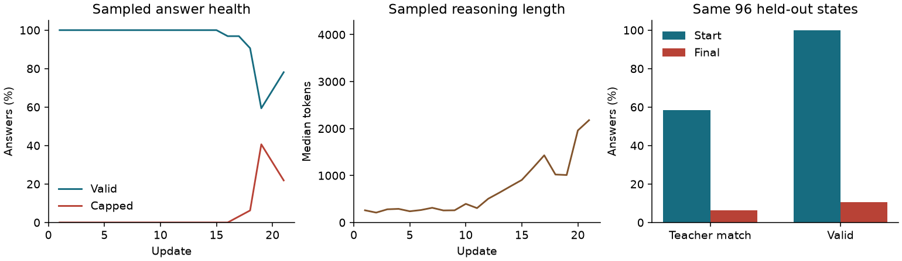

# Broader training collapsed into repetitive output

**Status:** finished 27 October 2026. **Verdict:** worse: held-out teacher
matches fell from 56/96 to 6/96, mostly because answers never reached a valid ending.

## Question

Does continuing the passing stage-1 adapter on broader decisive states improve
held-out decisions while preserving valid answers and reasoning?
Approach: [teacher feedback](../strategies.md#teacher-feedback-rl-followed-by-full-game-outcomes).

## Design

Sid authorized a longer monitored laptop run on 26 October and explicitly
preferred progress over another seed repeat. This is exploratory signs-of-life
work, not a confirmation study. The proposed repeat, KL arm and larger-batch arm
are deferred. No external compute is used.

Start from the stage-1 adapter at iteration 48, learning rate 0.00003. The saved
adapter has no optimizer state, so AdamW starts fresh. Keep medium effort,
rank-16 LoRA, 4 states per step, 8 samples per state, temperature 0.6, the
4,096-token cap, per-sample shuffled menus, group-mean advantages, fixed
2,048-token loss denominator, invalid reward −1 and zero KL penalty.

Use 512 training states (256 per phase, 436 worlds), versus 32 in stage 1.
One selected state overlaps the earlier 32. Select by teacher margin at least
0.3 and spread over decision types. Labels come from the same frozen champion
and the existing local corpus. Training remains on the filtered 0.1.5.1
observations; no simulator or prompt change is mixed into this run. The known
potion-text inconsistencies are excluded by the existing selector.

The fixed held-out panel has 96 states (48 per phase, 73 worlds), with zero
world overlap with either this run or the parent adapter's training states.
These are validation worlds and may have been inspected previously, not fresh
confirmation worlds. A fixed 64-state training subset provides a cheaper
comparison. Evaluate both before training and every 32 steps with one fixed
menu order per state. Report paired world-cluster 95% intervals for changes
from this run's starting adapter, separately by phase and overall.

Budget: up to 256 optimizer iterations, 8,192 responses and two passes over the
512 states, or eight elapsed hours before the final checkpoint/evaluation.
The earlier passing run spent about 108 minutes in 48 training iterations;
continuation may be faster or slower as reasoning lengths change. Save every
eight steps. Pause on battery and preserve completed outputs when stopping.

Monitor teacher agreement and probability, validity, cap rate, reasoning-token
distributions, group diversity, A-answer share against the content-only rate,
and agreement when the teacher's top action is not A. The probe is diagnostic,
not a reward. No reasoning trace is supplied and no length reward is added.

Rules chosen before training:
- Stop and inspect if validity is below 90% in each of two consecutive
  256-response windows.
- Stop and inspect if held-out agreement is at least 10 percentage points
  below the starting adapter and teacher probability is lower, at two
  consecutive evaluations.
- Flag sustained A-answer share above 70%; inspect content agreement before
  deciding whether it is a harmful shortcut.
- Stop and inspect a process error or 20 minutes without new progress.
- Otherwise continue to the budget. A rising held-out score motivates more
  training; a flat or worsening score motivates a targeted change rather than
  seed repeats. No automatic checkpoint selection is a confirmation result.

## Results

The final adapter failed on both phases and both fixed panels. These are all
saved evaluations: the starting adapter and the adapter after 21 updates.
Every before/after pair used the same state and menu order. Differences below
are percentage points with 95% world-cluster bootstrap intervals; all evidence
is **Exploratory**. Invalid and capped answers count as disagreement.

| Panel | States / worlds | Teacher matches, start → final | Difference [95% interval] | Final valid |
|---|---:|---:|---:|---:|
| Held-out · all decisions | 96 / 73 | 56 → 6 | -52.1 [-62.1, -41.8] | 10/96 |
| Held-out · combat | 48 / 48 | 35 → 4 | -64.6 [-77.1, -50.0] | 4/48 |
| Held-out · out of combat | 48 / 48 | 21 → 2 | -39.6 [-54.2, -25.0] | 6/48 |
| Training panel · all decisions | 64 / 64 | 31 → 6 | -39.1 [-51.6, -26.6] | 13/64 |
| Training panel · combat | 32 / 32 | 20 → 5 | -46.9 [-65.6, -31.2] | 5/32 |
| Training panel · out of combat | 32 / 32 | 11 → 1 | -31.2 [-46.9, -15.6] | 8/32 |

All 160 initial evaluation answers were valid. Final failures were exclusively
truncations: 51/64 on the training panel and 86/96 held out. Teacher probability
fell from 0.396 to 0.070 on the training panel (−0.326 [−0.417, −0.238]) and
from 0.505 to 0.052 held out (−0.452 [−0.541, −0.364]). All phase-specific
probability changes were negative with intervals below zero; the complete
metrics and intervals are in [the CSV](../figures/broader-training/comparisons.csv).

Figure data: [training](../figures/broader-training/training.csv) and
[comparisons](../figures/broader-training/comparisons.csv).

**Valid-pairs-only sensitivity is inconclusive.** Among the 13 training-panel
answers valid at both endpoints, teacher matches changed 9 → 6 (−23.1 points,
95% interval −46.2 to 0); teacher probability changed by −0.188 [−0.409, 0].
Among the 10 held-out answers valid at both endpoints, matches changed 8 → 6
(−20.0 points, −60.0 to +20.0); teacher probability changed by −0.184
[−0.556, +0.200]. These small selected subsets cannot rescue the primary result.

**Training stopped before a full pass.** It completed 21 updates and 672 sampled
answers on 84 of the 512 states; 14 of the 64 training-panel states were seen.
There were 637 valid answers, 33 caps, one malformed final JSON and one illegal
label. The last two steps available when stopping was requested had 23 caps
among 64 answers. Saved traces repeat phrases such as “Probably the A is A”
until the cap. Final greedy reasoning had median 4,096 tokens in every panel,
against 175 held out and 198 on the training panel initially.

**Time:** approximately 127 minutes excluding logged power pauses: 63 minutes
of updates, 5 minutes for the baseline, and 60 for the final evaluation. The
final evaluation generated 588,220 tokens and finished at 11:48 GMT on 27 October.
Raw timers include awake battery pauses and must not be reported as compute time.

## Conclusion

The small-set learning result did not yield a stable broader continuation.
The observed failure is repetitive generation and failure to finish answers;
we have no evidence that latent decision preferences improved. The original
passing adapter remains the working reference. No game evaluation was run.

Caveats:
- Teacher agreement measures imitation, not game strength; decisive states are selected.
- This was one warm-started run with reset optimizer moments and zero KL penalty.
  Its failure does not isolate which setting caused the drift.
- Stopping was adaptive, before the automatic two-window rule fired. Only the
  initial and final checkpoints were evaluated; intermediate checkpoints are preserved.
- Greedy evaluation and sampled training differ in states, temperature and update point.
- Each state had one fixed evaluation order; valid-pairs-only subsets are selected.

## Next

Run a targeted stability comparison, not another seed repeat: a lower learning
rate versus a small measured KL penalty, starting from the original passing
adapter and retaining the broader states. First log policy-loss and KL components;
the current KL reference is the foundation model, not the passing adapter.
The comparison is proposed, not launched. Adopt environment 0.1.6 before a new
simulator corpus or game evaluation.

## Log

- 26 October: Sid prioritized a longer monitored run over a seed repeat. Validation
  selection used 48 states per phase because only 50 eligible combat worlds existed.
- 26 October: requested a safe stop after step 20 due to repetition, 23/64 caps,
  and seven-to-eight-minute steps. Step 21 finished and its adapter was preserved.
- 27 October: final evaluation completed after the overnight power pause; both
  fixed panels deteriorated. No further experiment was started.

Code: `experiments/2026-10-26-broader-training/` and `src/sts_llm/`; training at
commit 05476ed. Data: `broader_training_20261026` and
`broader_states_selected_20261026` (local). Analysis: `analyze.py` in the code folder.
