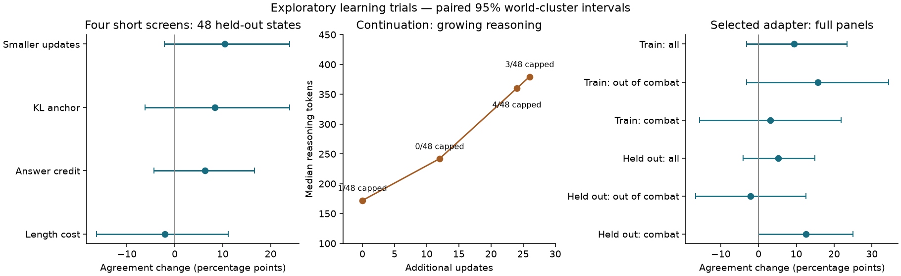

# Four short trials to find a stable learning signal

**Status:** finished 27 October 2026. **Verdict:** tentative combat learning, but no reliable overall improvement and worse answer validity; retain the original adapter as the working reference.

## Question
Can teacher-feedback RL improve broader decisions without teaching repetitive output?
Sid authorized about four hours on this MacBook on 27 October, prioritizing signs
of life over seed repeats and explicitly requiring medium effort instead of low effort.

## Design
All four screens started from the passing stage-1 adapter with fresh AdamW,
learning rate 0.00001, 512 training states from 436 worlds, four states × eight
sampled responses per iteration, shuffled letter menus, teacher-probability
rewards, invalid reward −1 and a fixed 2,048-token loss denominator. No SFT.
All used medium effort and a 1,024-token output cap. The previous failed broader
run used 4,096 tokens, so it is historical context, not a matched control.

| Screen | Reward-gradient tokens | Frozen-adapter KL | Length cost |
|---|---|---:|---|
| Smaller updates | Whole completion | 0 | None |
| KL anchor | Whole completion | 0.05 | None |
| Answer credit | Reasoning closer, answer, end token | 0.05 on whole completion | None |
| Length cost | Whole completion | 0.05 | 0.1 per 256 reasoning tokens beyond 256, valid answers only |

Invalid/capped responses stayed at −1. Evaluation scores excluded the length
cost. Answer-credit responses without a closer had no policy-gradient tokens;
KL still acted and their rewards contributed to the group baseline.
Each screen received about 25 minutes plus stopping evaluation. Fixed screening
panels contained 16 training-pool states/16 worlds and 48 validation states/44
worlds, balanced by phase. Evaluate at the start, every 12 iterations and stopping;
stop promptly if recent sampled validity falls below 80% or behavior deteriorates.
Select the usable final screen with highest held-out teacher probability (at least
90% valid), continue within budget, then compare original and selected adapters
on 64 training-pool and 96 validation states. Selection is exploratory.
The continuation reset Adam moments and changed training order; its reference
anchor, if used, remained the original adapter. Deadline: 17:51:49 London time,
with an already-running bounded final evaluation allowed to finish. No external compute.

## Results
The selected adapter improved held-out matches from 56 to 61/96, but the paired
interval includes no improvement and validity fell from 96 to 90/96. Combat
teacher probability improved; out-of-combat performance did not. All results
below are **Exploratory**. Brackets are descriptive 95% world-cluster intervals.

| Full-panel comparison | Decisions / worlds | Teacher matches, start → final | Agreement change, points [95% interval] | Teacher-probability change [95% interval] | Valid, start → final |
|---|---:|---:|---:|---:|---:|
| Held out: all | 96 / 73 | 56 → 61 | +5.2 [−4.1, +14.9] | +0.020 [−0.056, +0.097] | 96 → 90 |
| Held out: combat | 48 / 48 | 35 → 41 | +12.5 [+0.0, +25.0] | +0.056 [+0.006, +0.111] | 48 → 47 |
| Held out: out of combat | 48 / 48 | 21 → 20 | −2.1 [−16.7, +12.5] | −0.016 [−0.161, +0.126] | 48 → 43 |
| Training pool: all | 64 / 64 | 31 → 37 | +9.4 [−3.1, +23.4] | +0.076 [−0.025, +0.182] | 64 → 58 |
| Training pool: combat | 32 / 32 | 20 → 21 | +3.1 [−15.6, +21.9] | −0.005 [−0.077, +0.066] | 32 → 28 |
| Training pool: out of combat | 32 / 32 | 11 → 16 | +15.6 [−3.1, +34.4] | +0.158 [−0.031, +0.339] | 32 → 30 |

Held-out validity changed by −6.2 [−11.6, −2.0] points; training-pool validity by
−9.4 [−17.2, −3.1]. All 12 invalid final answers reached the cap. Held-out median
reasoning grew from 175 to 371 tokens; training median from 198 to 424.5.
Held-out first-displayed-option rate was 32.3% → 31.1% of valid answers: no upward drift observed.

Every saved evaluation is listed below. Iterations count sampled training batches;
the continuation had 26 batches but 25 optimizer updates because one had no
policy gradient. The selected adapter therefore has 40 optimizer updates after
the original adapter. The continuation-start evaluation reproduces the first
screen's final result; all four original screening evaluations are identical.

| Evaluation, iteration | Training matches | Held-out matches | Teacher probability, train / held out | Valid, train; held out | Held-out median reasoning tokens |
|---|---:|---:|---:|---:|---:|
| Smaller updates, 0 | 10/16 | 22/48 | 0.476 / 0.424 | 16/16; 48/48 | 188 |
| Smaller updates, 12 | 9/16 | 26/48 | 0.452 / 0.471 | 16/16; 48/48 | 182 |
| Smaller updates, 15 | 8/16 | 27/48 | 0.345 / 0.478 | 16/16; 47/48 | 172 |
| KL anchor, 0 | 10/16 | 22/48 | 0.476 / 0.424 | 16/16; 48/48 | 188 |
| KL anchor, 11 | 7/16 | 26/48 | 0.371 / 0.478 | 16/16; 48/48 | 190.5 |
| Answer credit, 0 | 10/16 | 22/48 | 0.476 / 0.424 | 16/16; 48/48 | 188 |
| Answer credit, 12 | 8/16 | 25/48 | 0.389 / 0.475 | 16/16; 48/48 | 183 |
| Length cost, 0 | 10/16 | 22/48 | 0.476 / 0.424 | 16/16; 48/48 | 188 |
| Length cost, 12 | 8/16 | 21/48 | 0.392 / 0.424 | 16/16; 48/48 | 199.5 |
| Continuation, 0 | 8/16 | 27/48 | 0.345 / 0.478 | 16/16; 47/48 | 172 |
| Continuation, 12 | 11/16 | 27/48 | 0.539 / 0.504 | 16/16; 48/48 | 242 |
| Continuation, 24 | 9/16 | 28/48 | 0.454 / 0.509 | 15/16; 44/48 | 360 |
| Continuation, 26 | 9/16 | 28/48 | 0.388 / 0.505 | 15/16; 45/48 | 379.5 |
| Full starting adapter, 0 | 31/64 | 56/96 | 0.396 / 0.505 | 64/64; 96/96 | 175 |
| Full selected adapter, 0 | 37/64 | 61/96 | 0.472 / 0.525 | 58/64; 90/96 | 371 |

Every post-training screening comparison against the original adapter:

| Evaluation, iteration | Training agreement change, points | Held-out agreement change, points | Training probability change | Held-out probability change |
|---|---:|---:|---:|---:|
| Smaller updates, 12 | −6.2 [−25.0, +12.5] | +8.3 [−5.9, +21.7] | −0.025 [−0.200, +0.162] | +0.047 [−0.071, +0.161] |
| Smaller updates, 15 | −12.5 [−37.5, +12.5] | +10.4 [−2.2, +23.9] | −0.132 [−0.319, +0.018] | +0.054 [−0.051, +0.160] |
| KL anchor, 11 | −18.8 [−43.8, +6.2] | +8.3 [−6.2, +23.9] | −0.105 [−0.316, +0.104] | +0.054 [−0.063, +0.173] |
| Answer credit, 12 | −12.5 [−31.2, +0.0] | +6.2 [−4.3, +16.7] | −0.087 [−0.236, +0.000] | +0.051 [−0.041, +0.140] |
| Length cost, 12 | −12.5 [−31.2, +0.0] | −2.1 [−16.3, +11.1] | −0.084 [−0.221, +0.000] | −0.001 [−0.108, +0.105] |
| Continuation, 12 | +6.2 [−18.8, +31.2] | +10.4 [+0.0, +22.4] | +0.063 [−0.144, +0.271] | +0.080 [−0.018, +0.182] |
| Continuation, 24 | −6.2 [−25.0, +12.5] | +12.5 [+0.0, +25.0] | −0.023 [−0.205, +0.162] | +0.085 [−0.014, +0.188] |
| Continuation, 26 | −6.2 [−25.0, +12.5] | +12.5 [−1.9, +26.5] | −0.089 [−0.259, +0.041] | +0.081 [−0.028, +0.193] |

The four short arms remained usable, with no clear advantage between them.
Length cost showed no shortening or learning benefit at this duration. The
smaller-update screen was selected by 0.4784 versus the KL arm's 0.4779 teacher
probability; this tiny difference does not establish a winner. Its continuation
reached median held-out lengths of 172, 242, 360 and 379.5 tokens. At iteration
24, five of 64 fixed-panel answers capped; saved traces copied menus/map text
and included a repetitive “Clash+” loop. We requested STOP, preserved the
in-flight iteration and final checkpoint at 26, then finished the full comparison.

The remaining validation states did not show an agreement gain. These post-hoc
subsets use the matched full-panel menus; they are not fresh-world confirmation.

| Full-panel validation subset | Decisions / worlds | Matches, start → final | Agreement change, points | Probability change |
|---|---:|---:|---:|---:|
| Previously screened states | 48 / 44 | 25 → 30 | +10.4 [−4.1, +25.5] | +0.047 [−0.069, +0.170] |
| Other validation states | 48 / 41 | 31 → 31 | +0.0 [−13.0, +13.0] | −0.007 [−0.107, +0.095] |

## Conclusion
Smaller updates postponed the previous rapid collapse and produced a tentative
combat-preference signal. They did not solve growing reasoning or establish a
reliable overall gain. Retain the original passing adapter; preserve all candidates.

- Panels were reused for inspection and selection; intervals do not account for that selection or training-seed variability.
- Full-panel menus match between adapters but differ from screening menus; absolute scores across those panels are not directly comparable.
- Screens used equal time, not equal optimizer steps; the KL arms cost more per iteration. This was a practical learning-speed screen, not an isolated mechanism proof.
- Rewards reflect a frozen policy's preferences, not game correctness or win rate. No full games were run.
- The final evaluation paused on battery for about 56 minutes and finished at 18:05; training had stopped before the deadline. No extra training allocation was used.

## Next
A targeted next trial should separate action learning from reasoning-length control:
scale answer-token reward gradients independently, apply an explicit full-completion
length cost, and anchor medium-effort reasoning to the original adapter with KL.
The answer-credit screen's fixed whole-completion denominator also reduced its
gradient scale, so its result does not isolate credit assignment. This is a
hypothesis for the next authorized experiment; no further experiment was started.

Code: `experiments/2026-10-27-learning-trials/`; training source at `f583ce2`,
analysis in `summarize.py` saved with this report. Data: run `learning_trials_20261027`.
All evaluations and intervals: [evaluation CSV](../figures/learning-trials/evaluations.csv),
[comparison CSV](../figures/learning-trials/comparisons.csv), and run `trial_comparisons.json`.
