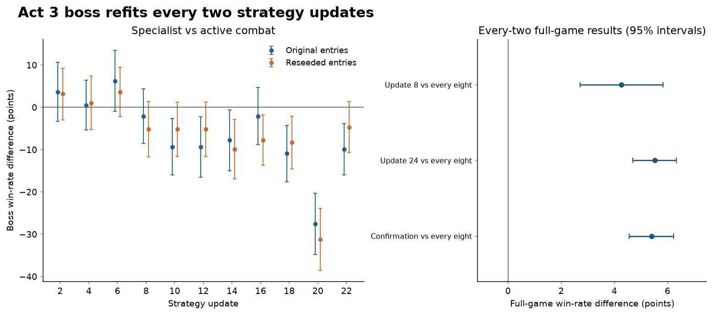

# Can better Act 3 boss combat improve the champion?

**Status:** finished 19 November 2026. **Verdict:** Refitting every two strategy updates produced the new champion. It won 39.42% of 16,384 independent games against 34.03% for every eight, a paired gain of 5.40 points [4.56, 6.23].

## Question

Does refitting combat for the Act 3 boss improve on another 24 iterations of strategy training from the [November champion](2026-11-18-paired-ppo-rates.md)? On its independent confirmation panel the champion lost 4,714 games at that boss, including 2,626 entered at full health.

## Design

Sid approved the champion, 24 updates at 0.0001, a frozen-combat control, and refits after updates 8 and 16 on 18 November. The following sample sizes and decision rules were chosen for this run before inspecting outcomes.

- Both arms use the same 3,072 fresh training worlds per update, optimizer settings and evaluation protocol. The control trains continuously. Until the first accepted refit the joint arm shares the exact control checkpoints, including optimizer, training random state and return normalization.
- At each milestone collect decisions from the active policy on 512 separate worlds. The student plays. At Act 3 boss choices the teacher runs 24 publicly reseeded searches of 1,000 simulations. Fit one fresh large legacy combat head per milestone on pooled action values at scale 100. Use only the current milestone's corpus. Select the checkpoint on validation loss and defer test scoring.
- Freeze 192 Act 3 boss entries from 512 independent worlds per milestone before fitting. Compare both players on identical replayed fights. Require more wins on the original unsalted entries. One additional salted replay per entry is diagnostic. A tied fight comparison keeps the active head.
- If the fight gate passes, compare the proposed and active policies on 4,096 separate matched full games. Adopt the specialist only if its paired win gain is positive even under the worst assignment of unresolved outcomes. It plays only combat in a public Act 3 boss room, including bosses reached through Secret Portal. Strategy PPO resumes at the next iteration. A rejected refit leaves the current combat policy in place.
- Evaluate both iteration-24 endpoints on 16,384 fresh matched worlds. Use greedy evaluation with seven processes and eight games per process for every full-game comparison. Choose the joint arm if its worst-case paired gain is positive, otherwise the control. Freeze the selection before running it and the starting champion on another 16,384 matched worlds. Promote only on a positive lower bound of the paired 95% interval on confirmation, robust to unresolved outcomes.
- Development evaluations on the usual 1,024 worlds every four updates are descriptive. Report faults, cuts and missing outcomes separately. Operational failures require recovery and verification before moving on.

### Every two updates

Sid requested a second schedule on 18 November after the first update-8 result and before the first study's final evaluation. It begins only after that study finishes confirmation. Both schedules start from the identical November champion and use the same 24 PPO updates and assigned worlds.

- At updates 2, 4, …, 22, repeat the same fit and the same two gates. Each fit gets 512 on-policy teacher worlds. The total is 5,632 planned teacher worlds versus 1,024 for the first schedule. Both schedules use identical label, boss-entry and full-game gate rosters at their common milestones of 8 and 16. Other milestones have disjoint rosters.
- Resume the strategy optimizer, RNG and return normalization across each two-update segment. The trainer also records its usual 1,024-world development check at each segment boundary. Those extra observations do not select a refit or endpoint. Verify the trajectories against frozen combat while the two arms still share a policy. A denied gate keeps the previous combat policy. Report every gate and each run's elapsed time.
- On independent paired worlds compare the post-gate update-8 policies (4,096 games). At update 24 compare every two with every eight and with frozen combat (16,384 fresh worlds). Use the same evaluation batching and fault accounting as the first study.
- If the every-two endpoint beats both comparators under the least favourable assignment of unresolved wins, freeze it for independent confirmation on 16,384 further worlds against every eight and the incumbent resulting from the first study. Promote only if both paired 95% lower bounds exceed zero under that assignment. The update-8 result cannot select an endpoint.
- Follow the run on the [live progress page](http://127.0.0.1:8795/progress). The local heartbeat verifies processes, progress and power every 15 minutes. The follow-up run is `joint_a3_every2_from_0f52`.

## Results

The every-two arm won 884 more games on independent confirmation. All three cadence panels returned the full set of paired outcomes without faults or cutoffs.

| Comparison | Every two | Every eight | Paired gain in percentage points, 95% interval |
|---|---:|---:|---:|
| After the update-8 gate, 4,096 worlds | 1,550 (37.84%) | 1,375 (33.57%) | +4.27 [+2.71, +5.84] |
| Update 24, 16,384 fresh worlds | 6,468 (39.48%) | 5,564 (33.96%) | +5.52 [+4.70, +6.34] |
| Independent confirmation, 16,384 more worlds | 6,459 (39.42%) | 5,575 (34.03%) | +5.40 [+4.56, +6.23] |

Every eight and frozen combat finished with identical weights because both proposed refits were rejected. Their endpoint subsequently became the incumbent. Its saved evaluation therefore serves both roles in each final cadence panel.

### Every-two gate decisions

The specialists fitted at 2, 4 and 6 all passed both gates. Each later candidate lost on the original saved boss entries. The table gives candidate wins against active-policy wins. For an incomplete full-game panel it gives the interval on completed pairs and the possible gain over all assigned worlds.

| Update | Original boss entries | Reseeded entries | Full-game gate | Decision |
|---|---|---|---|---|
| 2 | 114 vs 107 of 192, +3.65 points [-3.35, +10.64] | 122 vs 116 of 192, +3.12 points [-3.00, +9.25] | 1,475 vs 1,427 wins on 4,096 assigned worlds, 4,095 complete pairs. +1.17 points [-0.00, +2.35] on complete pairs, full-cohort bounds [+1.15, +1.20] | Adopted |
| 4 | 127 vs 126 of 192, +0.52 points [-5.36, +6.40] | 117 vs 115 of 192, +1.04 points [-5.27, +7.35] | 1,484 vs 1,463 wins on 4,096 assigned worlds, 4,095 complete pairs. +0.51 points [-0.58, +1.61] on complete pairs, full-cohort bounds [+0.49, +0.54] | Adopted |
| 6 | 109 vs 97 of 192, +6.25 points [-0.93, +13.43] | 104 vs 97 of 192, +3.65 points [-2.21, +9.50] | 1,558 vs 1,459 wins on 4,096 assigned worlds, 4,096 complete pairs. +2.42 points [+1.32, +3.52] | Adopted |
| 8 | 105 vs 109 of 192, -2.08 points [-8.55, +4.38] | 105 vs 115 of 192, -5.21 points [-11.80, +1.38] | Did not advance | Kept active head |
| 10 | 105 vs 123 of 192, -9.38 points [-16.03, -2.72] | 103 vs 113 of 192, -5.21 points [-11.64, +1.22] | Did not advance | Kept active head |
| 12 | 110 vs 128 of 192, -9.38 points [-16.49, -2.26] | 113 vs 123 of 192, -5.21 points [-11.64, +1.22] | Did not advance | Kept active head |
| 14 | 104 vs 119 of 192, -7.81 points [-15.04, -0.59] | 105 vs 124 of 192, -9.90 points [-16.92, -2.87] | Did not advance | Kept active head |
| 16 | 112 vs 116 of 192, -2.08 points [-8.87, +4.70] | 110 vs 125 of 192, -7.81 points [-13.77, -1.86] | Did not advance | Kept active head |
| 18 | 97 vs 118 of 192, -10.94 points [-17.63, -4.25] | 101 vs 117 of 192, -8.33 points [-14.53, -2.14] | Did not advance | Kept active head |
| 20 | 58 vs 111 of 192, -27.60 points [-34.87, -20.34] | 56 vs 116 of 192, -31.25 points [-38.58, -23.92] | Did not advance | Kept active head |
| 22 | 98 vs 117 of 192, -9.90 points [-15.96, -3.83] | 98 vs 107 of 192, -4.69 points [-10.71, +1.33] | Did not advance | Kept active head |

### Eight-update gates and frozen control

The two rejected refits left strategy PPO as the only policy change from the starting champion. Its 24 updates produced an independently confirmed gain of 1.08 points, after which it became the comparator for the every-two endpoint. All games in the two full-game panels completed.

| Comparison | Result |
|---|---|
| Selected endpoint vs starting champion | 5,521 vs 5,344 wins on 16,384 assigned worlds, 16,384 complete pairs. +1.08 points [+0.33, +1.83] |
| Joint endpoint vs frozen control | 5,600 vs 5,600 wins on 16,384 assigned worlds, 16,384 complete pairs. +0.00 points [+0.00, +0.00] |
| Update 8 boss fights, unsalted | 100 vs 109 of 192 identical starts, -4.69 points [-11.67, +2.30] |
| Update 8 boss fights, resampled | 106 vs 93 of 192 identical starts, +6.77 points [+0.13, +13.41] |
| Update 16 boss fights, unsalted | 92 vs 93 of 192 identical starts, -0.52 points [-6.58, +5.53] |
| Update 16 boss fights, resampled | 91 vs 101 of 192 identical starts, -5.21 points [-11.80, +1.38] |

### Training time

| Schedule | Hours to post-gate update 8 | Hours to final policy |
|---|---:|---:|
| Every eight | 0.82 | 1.88 |
| Every two | 1.56 | 4.03 |

Eleven opportunities used 5,632 scheduled teacher worlds, compared with 1,024 for two opportunities. Elapsed wall time including evaluations and any power pauses was 4.86 hours for every two and 2.68 hours for the original study including its frozen control. This is one matched training seed.

## Conclusion

The early refits changed final-boss performance and the full-game advantage persisted through update 24. On independent confirmation, every two reached the Act 3 boss in 10,374 games and won 6,459 of those fights (62.26%). Every eight reached it in 10,236 games and won 5,575 (54.46%). Those groups contain policy-dependent entries, so the conditional rates describe where the extra wins occurred.

This comparison used one matched PPO seed and the same 73,728 training worlds. Eleven 512-world teacher collections cost 5.5 times as many scheduled worlds as two collections. Timing, compute budget and the number of chances to pass a gate all differed.

## Next

Test refits at 2, 4 and 6 against 8, 16 and 22 on a second matched PPO seed from the same starting champion. Three 512-world fits per arm would hold the teacher budget fixed while testing whether earlier refits transfer to a new training trajectory.

## Log

- 18 November: fixed the original two-gate design before training. Both arms shared the exact frozen-combat trajectory until a gate could admit a new head.
- 18 November: Sid requested the every-two comparison after the update-8 fight result and before the original endpoint evaluation. Its two final panels and promotion rule were fixed before its training began.
- 19 November: the frozen-combat endpoint passed its independent confirmation. The every-two arm then began from the original 18 November champion.
- 19 November: the every-two endpoint passed its independent confirmation and became champion.

Code: `experiments/2026-11-18-act3-boss-refits/`. The initial gate workflow was committed at `40a2153` and the follow-up supervisor at `307536a`. Local runs: `joint_a3_from_0f52` and `joint_a3_every2_from_0f52`.
