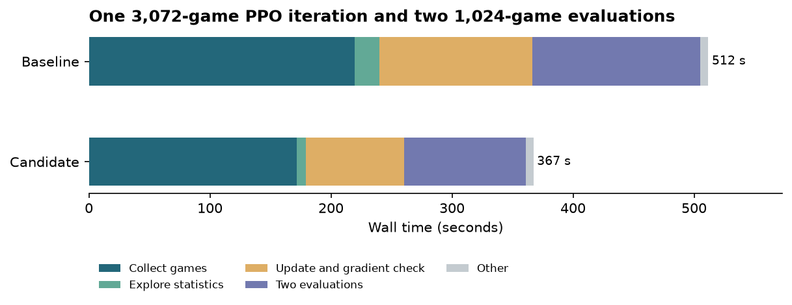

# Faster local training and evaluation on the Mac

**Status** — finished 18 November 2026. **Verdict** — one production-size MPS training job fell from 512 s to 367 s, with identical learned weights, optimizer state and game records.

## Question

Where does wall time go on the routes we actually use to train and evaluate Ironclad policies, and which code changes preserve the scientific comparison?

## Design

Sid requested a code-performance investigation on 18 November. All comparisons are exploratory. The Mac has an Apple M5 Pro, 15 CPU cores and 48 GiB unified memory. Timed workloads ran on AC power. The original environment and both workstreams were pinned; checkpoints and native builds are identified in the local run.

The full trainer ran once per arm in separate processes, candidate first. Both used the same champion, seeds, reward, PPO settings, twelve collectors, 384 game slots, 3,072 games, 128-game chunks and MPS updates. Each fresh job evaluated 1,024 worlds at the start and again at the endpoint. The two smaller trainer comparisons ran in ABBA order (two measurements per arm). Profiling was separate from timed comparisons. Intervals across independent full-size trials cannot be estimated from one pair.

## Results

### Production-size trainer

The normal trainer collected the same 3,072 episodes without faults, kept the same 308,191 out-of-combat decisions and took the same 228 optimizer steps in each arm.

| Wall time, seconds | Baseline | Candidate |
|---|---:|---:|
| Collect games and write the collection | 219.5 | 171.8 |
| Exploration diagnostics | 20.6 | 7.7 |
| PPO update including gradient-cosine diagnostic | 126.4 | 80.9 |
| Whole training iteration | **366.7** | **260.5** |
| Initial 1,024-world evaluation | 62.5 | 42.8 |
| Final 1,024-world evaluation | 75.9 | 58.2 |
| From process launch through both evaluations, checkpoints and exit | **511.7** | **367.2** |

Every training episode and every before/after evaluation record matched across implementations. Both arms won 292 evaluation worlds before the update and 283 afterwards. Model tensors, optimizer moments, trainer state and saved RNG states matched exactly. The read-only gradient-cosine metric changed from −0.0599971 to −0.0599594, and mean entropy changed by less than 0.000000001. Keep diagnostic placement fixed when comparing those measurements.

### Where the gains came from

1. The public combat wrapper asked for a full battle summary before and after each move, and again while rendering combat text, to read recent actions. It also requested the full hand to relabel ordinary actions. A narrow history accessor and fetching the hand only on multi-card selection menus preserve the rendered output. Older backends retain the summary path.
2. The trainer already offered MPS for PPO. The exploration-statistics forward pass and the gradient-cosine forward/backward pass still ran on CPU. The opt-in diagnostic setting uses the update device for both calculations. Collection and checkpoint storage stay on CPU.
3. The evaluator's indented JSON writer built one large string and a second encoded copy. Streaming bounded groups of JSON tokens retains byte identity, atomic replacement and synchronization to disk.

| Controlled comparison | Baseline | Candidate | Parity or limitation |
|---|---:|---:|---|
| Public stepping, median of two 40-game runs per arm, 9,415 decisions each | 283.1 µs/decision | 187.3 µs/decision | Separate golden fixture checks every public step. Timings exclude construction and IPC. |
| Champion evaluation, 32 worlds, 14,670 decisions, one process | 10.12 s | 7.96 s | Same recorded actions, outcomes, terminal hashes and behaviour counters |
| Sampled collector, 32 worlds, one process | 11.57 s | 9.56 s | Same completed episode records and zero faults |
| CPU trainer, 96 games, two collectors, environment change only | 38.21 s | 32.78 s | Same model, optimizer and evaluation records. Unseeded global Python/NumPy RNG differed in these early probes; both were explicitly seeded in subsequent tests. |
| MPS trainer, 384 games, six collectors, diagnostic placement only | 53.65 s | 46.82 s | Same model, optimizer, evaluation records and saved RNG states |
| Evaluation JSON, 8,192-world summary, two writes per arm | 737 MiB peak, 0.89 s | 295 MiB peak, 0.87 s | All 82,813,910 bytes matched. Peak includes reading the original file. |
| Gzip training record, 3,072 episodes, 18.3 MB uncompressed | 0.51 s | 0.094 s bounded, 0.085 s whole string | Same decompressed bytes. Saves about 0.4 s per iteration at this collection size. Kept as a prototype. |
| Legacy encoder, 2,048 sampled decisions | 0.486 s | 0.493 s skip zero, 0.493 s cache regex, 0.469 s both | All arrays and coverage counters matched. Small and inconsistent gains; encoder source kept intact. |

The champion evaluation profile covered 7,337 decisions. Public observation assembly took 3.91 s cumulatively and encoding took 3.10 s in the profiled 9.18 s run. Profiles include instrumentation overhead and nested calls. The environment and encoder both matter. The 24-iteration historical CPU run overlapped another trainer and had median iteration time 1,531 s; the previous isolated full-size CPU/MPS benchmark recorded 433 s and 306–329 s. Those historical timings are context and use different conditions.

### Evaluator workers and C++ search

With the production multiprocessing evaluator at eight game slots per process, the old wrapper took 21.73 s and the candidate 17.19 s on 224 worlds with seven processes (two timings per source). All 224 trajectory signatures matched. With the candidate alone, one, four and seven processes took 65.84, 22.18 and 15.96–18.41 s. All scored 65 wins. Changing worker count changed one trajectory relative to seven processes at both one and four workers. Keep worker and slot counts fixed across evaluations.

At one hallway entry and the Act 1, 2 and 3 bosses, the release-built teacher spent 99.6% of vote-query time and 97.9% of detailed-query time inside native search. Each decision used 24 futures and 1,000 simulations per future. Caching public menu-index translation across searches moved totals from 0.607 to 0.603 s for votes and from 0.614 to 0.599 s for details. All votes and root statistics matched. This is a small target.

Two fresh Release builds with the same compiler and flags tested a C++ alternative. Directly copy-construct the battle state and reuse the temporary playout edge vector across simulations. Across 12 actual encounter entries and both query methods, the normal mapping path took 9.21 versus 8.78 s per sweep (two fresh-process sweeps per build, each querying every position twice). All 24 position/method means favoured the candidate. Hashes of complete returned statistics and votes matched between builds, and all original fight states were preserved. This roughly 5% saving affects teacher labelling; the pure-policy PPO jobs above do not run search. The patch is an experiment for further teacher validation.

### Language model on Metal

The saved 0.9B K2 adapter spent most of its time generating or differentiating token sequences. Median historical iteration times for the four October screens were 79.6, 125.9, 119.4 and 111.2 s (15, 11, 12 and 12 iterations respectively); the 26-batch continuation took 95.6 s. The short unregularized screen spent 51.3 s generating, 27.5 s updating and effectively zero time scoring a reference. KL-anchored screens spent another 13 s per iteration scoring it. These are separate medians.

| MLX experiment | Baseline | Alternative | What changed |
|---|---:|---:|---|
| Greedy evaluation, 32 real prompts, eight at a time, two timings per arm | 36.04 s, 12.47 GB peak | 28.20 s, 11.15 GB, sorted by prompt length | Only 19/32 complete token sequences matched. The 96-token diagnostic cap was reached on 30 vs 31 responses. Exclude from transparent evaluation changes. |
| Sampled training generation, two actual eight-response groups, 1,024-token cap | 17.63 s, 3,795 generated tokens, 4.56 GB | 17.25 s, 4,094 tokens, 3.81 GB, reuse shared prompt prefix | All responses were valid; 10/16 actions and 0/16 full token sequences matched. The generated work differed. Keep outside the training recipe. |
| Gather selected logits before normalization, six real completions | 1.481 s | 1.459 s | Every token log-probability matched; same 3.49 GB peak. No clear material saving. |
| Backward pass for the first of those completions | 1.056 s | 1.043 s | Same loss and all 392 trainable gradient arrays. No clear material saving. |

### Verification

The environment suite passed all 281 tests with the native regression fixture. An isolated random-agent smoke on seed 3 replayed in a fresh process with all 21 steps verified. The combined workstream suite ran 1,294 tests with zero failures and three skips. A separate 48-test run covered the changed trainer, writer and worker paths with the workstream's original environment. The promoted champion and saved LLM adapters were read-only inputs.

## Conclusion

Use the leaner public observation path and enable the diagnostic-device option for comparable MPS runs. Use the streaming writer for large evaluations. Confirm environment adoption through the normal environment release procedure. The Python interface identity changes even with identical observations. Historical traces keep their original identity and are replayed with the recorded source.

Caveats include a single full-size pair on a shared laptop, short repeated comparisons on the same inputs, and numerical sensitivity of language-model decoding to batch composition. The OS reported 0.4 GiB swap in use before the large test and 3.6 GiB during its second arm. These are system-wide snapshots. No benchmark checkpoint was promoted.

[Individual timings](../figures/2026-11-18-mac-performance/timings.csv) and the [full-job breakdown](../figures/2026-11-18-mac-performance/full-iteration.csv) accompany the figure.

## Next

The first training run on the adopted environment can serve as a throughput monitor. Start from the existing champion. Keep the same PPO device, collector layout and inference batch shape across arms. Future changes to the legacy encoder should account for the source-bound checkpoint families.

## Log

- 18 November: profiled champion play and public stepping, screened execution alternatives, then measured a full-size unchanged scientific workload. The first trainer launch was blocked by sandboxed shared memory and produced no timing. The normal Mac process path was used for trainer comparisons.
- 18 November: the initial combined regression suite found two raw-native exception checks affected by an earlier test leaving its wrappers installed. The same two failures reproduced on the original workstream. Scoped the collector test's wrappers to its own test.

Code: [benchmark scripts](../../experiments/2026-11-18-mac-performance/), stored with this page. Environment candidate: `67def2e`. Baselines: main `b0d624f`, non-LLM `817d78f`, LLM `9ccf7b1`. Data: local run `mac_code_performance_20261118`.
