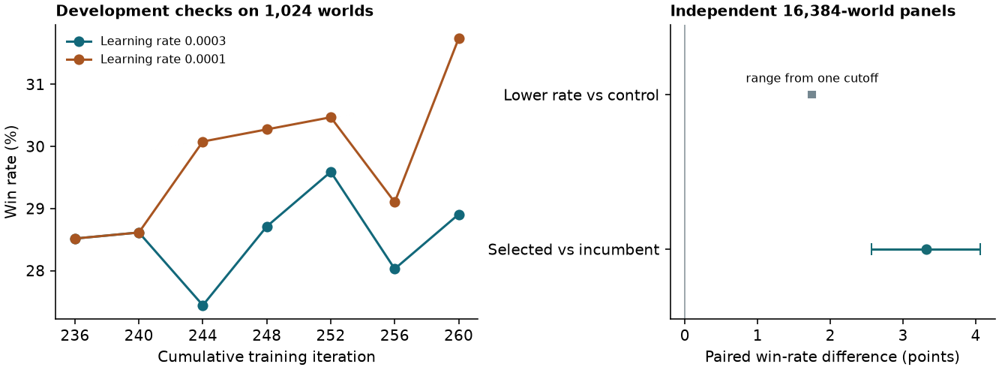

# Does a lower learning rate improve full-game play?

**Status** — finished 18 November 2026. **Verdict** — the lower-rate endpoint became champion with 5,502 wins against the incumbent’s 4,959 on 16,384 independent worlds (+3.31 points, 95% interval +2.57 to +4.06).

## Question

Does the lower rate preferred by the [offline learning audit](2026-11-18-ppo-audit.md) win more full games after the same 24 iterations?

## Design

Sid authorized both arms and independent confirmation on 18 November 2026. The control uses learning rate 0.0003 and the challenger 0.0001. Each starts from identical champion weights with fresh AdamW and inherited return scale. Combat is frozen. Each arm uses the same 73,728 fresh training worlds, in the same order, in 24 iterations of 3,072 games. The remaining settings are in the experiment config. The study uses env-v0.1.5.2, MPS for updates and diagnostics, and the original training menu filters.

Freeze the iteration-24 checkpoint from each arm. The 1,024-world checks during training are development measurements. Evaluate both endpoints greedily on the same 16,384 worlds from 125 billion, with seven processes and eight slots per process. Select the endpoint with more wins; an exact tie selects the control. Compare that selected endpoint with the starting champion on a separate 16,384 worlds from 126 billion, at the same topology. The paired win difference and a two-sided 95% interval determine confirmation. Retain the incumbent unless the interval lies above zero. Document faults and censoring separately, keeping every assigned world in the record. Use a paired large-sample interval on per-world win differences as in the audit. One training seed limits conclusions across seeds.

## Results

The 0.0001 challenger won selection and passed the independent confirmation rule.

| Panel | Reference wins | Challenger wins | Paired difference in percentage points [95% interval] |
|---|---:|---:|---:|
| Selection, 16,384 worlds assigned per arm | Control 5,068 | 5,354, one unresolved | +1.75 [+0.97, +2.52] on 16,383 completed pairs |
| Confirmation, 16,384 complete pairs | Incumbent 4,959 (30.27%) | 5,502 (33.58%) | **+3.31 [+2.57, +4.06]** |

One challenger game on the selection panel reached its decision limit. Either outcome on that world leaves the full-panel lead at 286–287 wins. Among completed pairs, 2,241 worlds went only to the challenger and 1,955 only to the control. On confirmation there were 2,222 challenger-only and 1,679 incumbent-only wins (exact McNemar p < 0.001). Neither panel had a simulator fault.

The selection marker spans the possible full-cohort differences from the one unresolved game. The confirmation error bar is the paired 95% interval.

| Development wins / 1,024 | Start | Iteration 4 | 8 | 12 | 16 | 20 | 24 |
|---|---:|---:|---:|---:|---:|---:|---:|
| Control | 292 | 293 | 281 | 294 | 303 | 287 | 296 |
| Challenger | 292 | 293 | 308 | 310 | 312 | 298 | 325 |

Both arms trained on all 73,728 scheduled worlds with identical first-iteration action traces. Each had two training episodes reach the task horizon and zero simulator faults. The control took 4,695 optimizer steps, with the KL guard stopping six iterations early. The challenger took 5,517 steps, with zero early stops. All combat weights matched the incumbent exactly in both endpoints.

On confirmation, the challenger reached the Act 3 boss in 10,216 games versus 9,723 for the incumbent. It lost 4,714 of those fights, including 2,626 entered at full HP. These counts locate opportunities for the next study; the two players reached different sets of fights.

## Conclusion

The smaller learning rate produced the stronger endpoint on this matched training seed. The independent panel confirms the selected player’s improvement over the starting champion. It compares the total effect of continued strategy training at the selected rate against the incumbent. A second training seed would test how reliably the lower rate wins the head-to-head.

## Next

Start a proposed joint study from champion `0f527a0fbf93`. Continue strategy PPO at 0.0001 in two matched arms. Freeze combat in the control. At iterations 8 and 16, fit an Act 3 boss specialist from pooled search values on fights reached by the joint arm. Check the specialist on identical saved boss entries, deploy it only for the Act 3 boss if it passes a paired full-game gate, and independently confirm the final endpoint. Sid requested a recommendation; this run has not started.

## Log

- 18 November, 19:04 GMT: both confirmation evaluators finished. The logger had stopped on a stale queue heartbeat during the power interruption. Restarting it recovered the final comparison from the saved records. The selected endpoint was frozen before either confirmation job started.

- 18 November, 14:00 GMT: the Mac switched to battery during challenger iteration 3. Preserved the iteration-2 checkpoint and queued recovery of the same complete training batch on AC.
- 18 November: selected one GPU training lane to preserve the benchmarked 12-collector, 384-slot configuration and fit the 48 GiB Mac. Independent policies in each evaluation panel can run concurrently.

Code: `experiments/2026-11-18-paired-ppo-rates/`. Local data: run `ppo_fresh_worlds_from_4058`.
