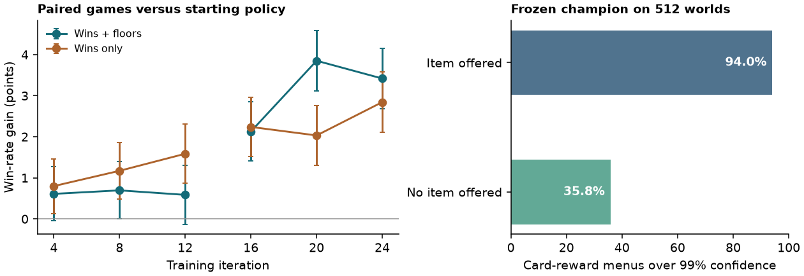

# Which PPO settings should we use next?

**Status** — finished 18 November 2026. **Verdict** — keep the standard recipe and use learning rate 0.0001 as the first challenger.

## Question

Which changes to the champion's [out-of-combat PPO](../strategies.md#out-of-combat-ppo-with-macro-credit) recipe warrant an online comparison?

## Design

Sid requested an ML-focused pass before the next run. This is an exploratory diagnostic study. No production continuation is part of it.

- Audit every iteration of both 24-iteration reward-ablation arms. Read the training objective, optimizer restoration, seeds, reward definition, GAE, sampling and evaluation paths.
- Collect one fixed diagnostic buffer of 512 training-split worlds starting at 124 billion with the frozen champion, its recorded return scale, the existing reward, macro credit, lambda 1 and the historical sampling rule. Retain complete episodes. Report faults and truncations explicitly.
- Compare actual menus, critic calibration and the previous champion on the current player's decisions. Separate mixed reward screens from menus containing only a card choice and skip.
- Split by whole world into two halves, fit disposable copies on each half, and score on the other. Try the original learning rate 0.0003 and three epochs, learning rate 0.0001, one epoch, strategic entropy 0.03, and restoring Adam moments. Change one setting per alternative. Use the same MPS device, shuffle, minibatch and 1,024-row microbatch in matched fits. Report every arm, exact action-distribution KL, greedy changes, clipped held-out surrogate change and critic error. The surrogate is a diagnostic and does not estimate full-game wins.
- Keep the online recipe as the default unless direct game evidence supports replacing it. A consistent diagnostic improvement can nominate one challenger. Reserve a fresh confirmation panel for a future frozen player.

## Results

**Keep the current recipe as the control. A lower learning rate is the strongest challenger on the decision proxy. Full-game evidence still favours spending the primary allocation on the established recipe.**

### Learning over full games

Both historical arms started from the same weights and trained on the same 73,728 worlds, 3,072 per iteration. These are paired full-game win-rate changes in percentage points versus their common starting policy. Intervals are descriptive 95% paired normal intervals over worlds. The first three checkpoints share one 16,384-world panel and the last three share another. At iteration 24 one standard-reward game reached its decision limit and is excluded from the paired comparison.

| Iteration | Wins plus floors [95% interval] | Wins only [95% interval] |
|---:|---:|---:|
| 4 | +0.61 [−0.05, +1.27] | +0.80 [+0.13, +1.47] |
| 8 | +0.70 [−0.00, +1.39] | +1.17 [+0.48, +1.87] |
| 12 | +0.59 [−0.13, +1.30] | +1.59 [+0.87, +2.30] |
| 16 | +2.13 [+1.41, +2.85] | +2.24 [+1.52, +2.96] |
| 20 | +3.85 [+3.11, +4.59] | +2.03 [+1.30, +2.76] |
| 24 | **+3.42 [+2.68, +4.16]** | **+2.84 [+2.11, +3.58]** |

The wins-only arm briefly led at iteration 12 and the standard reward led at iteration 20. Their final difference was 0.57 points in favour of the standard reward [−0.19, +1.34]. This is one optimizer seed per arm. Keep the terminal ±1 and 0.05 per floor. The earlier [batch-size study](2026-10-20-large-batch-ppo.md) found 190 vs 197 wins on 4,096 fresh worlds for 768 vs 3,072 games per update at equal training games. It used a weaker agent. Keep 3,072 for a clean continuation.

### PPO update size and exploration

The standard-reward run logged 7,401,888 out-of-combat choice transitions. Its median approximate KL was 0.0061, the median fraction of ratios beyond the 0.2 clip was 3.8%, and the per-minibatch KL guard stopped two of 24 iterations (after 23 and 151 optimizer steps). The wins-only arm had median KL 0.0064, clip fraction 3.8% and three early stops. A small iteration-average KL can coexist with a rejected minibatch. Neither run lost games to a simulator fault. The half-episode gradient cosine was negative in seven of 24 iterations in each arm; median 0.111 and 0.056 respectively. Larger steps or a looser guard have little support here.

Exploration increased over the standard run. Mean entropy rose from 0.173 in its first four iterations to 0.194 in its last four. The logged fraction of card-reward rows with a top action above 99% probability fell from 75.3% to 71.5%. These rows comprised 45.3% of the choices and included free items on the same menu.

The frozen champion won 127/512 sampled diagnostic games, with zero faults or cutoffs and 51,572 usable decisions. On its card-reward menus, saturation was **94.0% of 14,389** with other items, and **35.8% of 8,694** without those items. The previous champion and current champion picked different top actions on 0.9% and 12.4% respectively on those same rows. In a follow-up on the first 256 worlds, 6,783/7,208 mixed menus were saturated. The top choice was gold 4,296 times, a potion 1,956, a relic 516 and a card 15. Raising entropy on all rewards would also push against reliable item collection. The trainer now reports both subgroup counts and saturation fractions alongside the existing aggregate.

The critic's mean residual was −0.0004 in raw reward units, but it explained only 17.7% of decision-level return variance overall. Within Acts 1, 2 and 3 it explained 7.1%, 8.4% and 14.9%. Lambda 1 keeps the critic as a baseline for complete episodes while allowing late rewards to reach early choices. The return-minus-value identity held to floating-point precision. Keep the detached value head, return scaling, gamma 1 and lambda 1. A more predictive early-act critic is a separate variance-reduction study.

### Optimizer probes on held-out worlds

Each fit used 256 worlds. The two folds supplied 24,626 and 26,946 training decisions. Models were scored on the opposite 256 worlds. The score is the change in the clipped importance-weighted advantage in raw reward units, averaged within each world and then across worlds. An unchanged policy scores zero. The intervals resample worlds conditional on these two fits. Positive differences versus the control can reflect a smaller, less damaging update.

| Disposable fit | Held-out score vs start | Difference vs control [95% interval] | Exact KL from start | Greedy actions changed |
|---|---:|---:|---:|---:|
| Current learning rate 0.0003, three epochs, fresh AdamW | −0.00521 | reference | 0.00636 | 1.55% |
| Learning rate 0.0001 | −0.00102 | **+0.00419 [+0.00306, +0.00553]** | 0.00162 | 0.80% |
| One epoch | −0.00302 | +0.00219 [+0.00084, +0.00381] | 0.00524 | 1.35% |
| Strategic entropy coefficient 0.03 | −0.00504 | +0.00016 [−0.00012, +0.00048] | 0.00614 | 1.55% |
| Restore the champion's Adam moments | −0.00403 | +0.00118 [+0.00048, +0.00196] | 0.00512 | 1.45% |

The lower rate ranked first in both folds and was still below zero [−0.00198, −0.00016]. These fits took 7–21 optimizer steps, compared with about 228 per full iteration. A clipped surrogate penalizes large changes and cannot establish a win-rate gain. Doubling down on noisy gradients, or raising entropy everywhere, would be premature.

### Training versus deployment choices

The historical `combat=greedy` training path scales logits by 10,000 and samples, so near-ties can resolve differently from deployment argmax. Four frozen-policy arms played the first 256 diagnostic worlds in the same collector layout with matched seeds. Training-style sampling won 64. Exact combat and sampled strategy won 70 (+2.34 points [−3.59, +8.28]); historical combat and exact strategy won 68 (+1.56 [−3.52, +6.65]); exact choices in both phases won 69 (+1.95 [−3.19, +7.09]). All games terminated normally. The panel cannot distinguish the win rates. Keep the control's sampling behaviour and use the dedicated greedy evaluator for promotion.

## Conclusion

Actual game outcomes justify another 24-iteration block. For a two-arm study, change only the learning rate. The one-epoch and carried-moment probes were intermediate and stronger entropy gave no clear advantage. Caveats are one historical optimizer seed, two small complementary fits, reused historical evaluation panels and a small follow-up on a subset of the diagnostic worlds. No optimizer-probe checkpoint was saved or promoted.

## Next

- **One arm:** use [the prepared control settings](../../experiments/2026-11-18-ppo-audit/next-control.json), starting from champion `4058cbf0e271` with a frozen combat head. Use fresh AdamW, inherit the unchanged reward's running return scale (1.251), learning rate 0.0003, three epochs, minibatch 4,096, microbatch 1,024, ratio clip 0.2, KL guard 0.05, value weight 0.5, gradient norm cap 0.5, zero weight decay and strategic entropy 0.01. Keep both existing menu filters. Use MPS updates and diagnostics.
- **Two arms:** identical settings, initialization, world order and compute, with the second learning rate set to 0.0001. Use iteration 24 as the endpoint. Treat intermediate evaluations as development data. The starting checkpoint loads weights; fresh runs initialize AdamW. A resume from `latest.pt` also restores optimizer and RNG states and continues its iteration count.
- **World allocation:** the last performance benchmark replayed all 3,072 training worlds from the previous arm's iteration 1. That check establishes execution parity. Repeating the old seed and start offset would recycle training data. The proposed seed 8 and world-start parameter 128 billion generate 73,728 distinct worlds across 24 iterations, starting at 132,010,000,000. They are disjoint from the 217 iteration starts in 27 retained trainer configs checked.
- **Decision rule for the proposed run:** compare frozen endpoints on the same 16,384 worlds from 125 billion, using the same greedy evaluator topology and paired wins. Use an independent 16,384-world panel from 126 billion to confirm the selected endpoint against the incumbent. Retain the incumbent if the paired 95% interval includes zero. Report incomplete cohorts separately. Neither panel was used here.

## Log

- 18 November: the exploratory card-context result led to a follow-up on the first 256 diagnostic worlds and to two additional logging counters and fractions. The original aggregate is preserved.
- 18 November: all ten disposable fits completed; the champion remains unchanged. The next full training run is unqueued.

Code: [audit and settings](../../experiments/2026-11-18-ppo-audit/). Data: local run `ppo_learning_audit_20261118`. [All paired game comparisons](../figures/2026-11-18-ppo-audit/game-outcomes.csv), [optimizer folds](../figures/2026-11-18-ppo-audit/optimizer-folds.csv), and [paired surrogate comparisons](../figures/2026-11-18-ppo-audit/paired-surrogates.csv).
