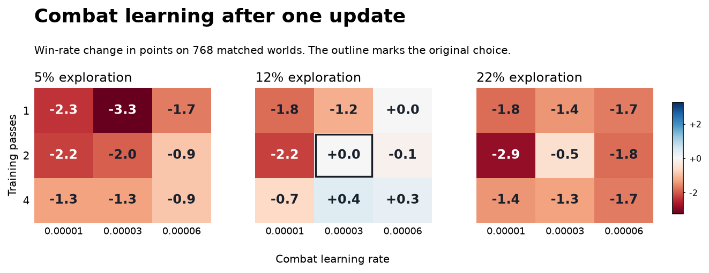

# Can the fighter and strategist learn together from the same games?

**Status:** running. The experiment compares enabling and freezing combat learning under the same measured exploration rule.

## Question

Does updating the card player on every batch improve whole-game wins over the same strategy training? The [previous direct trial](2026-10-14-joint-sparse-win-ppo.md) averaged 36 winning games per update. This champion already wins about 39% of full games.

## Design

Sid requested 24 matched updates and a pilot on 19 November, from the confirmed 39.42% player that started the equal-budget refit study. The choices below are the experimenter's, fixed before pilot results.

- Sample alternative legal moves according to the fighter's scores. Calibrate ordinary fights and final-boss fights separately on 192 training worlds. Aim for 5%, 12% and 22% probability of a strictly lower-ranked move on menus with a meaningful choice. Equal best scores count as a tie. Compare those three rules with the existing near-greedy fighter on 768 matched worlds each, including whole-game wins, Act 3 reach, faults and achieved exploration. Prefer 12%, then 5%, then 22%, among settings within five points of the baseline win rate and eight points of its Act 3 reach. If all fail, test a 2.5% target before selection. If none meets the thresholds, report the tradeoff and decide before launching production. These are screening thresholds, not population claims.
- Fit combat from a common frozen collection at the selected exploration rule, using 3,072 further training worlds. Learn from complete-game returns under the existing floor and terminal rewards. Estimate the expected return from other worlds in the same batch using public act, room and health. Sample at most 32 ordinary and 16 final-boss choices per game to bound memory and give the boss its own update. Train both combat policies from their current weights, with independent optimizers. Compare rates 0.00001, 0.00003 and 0.0001 with one pass, and 0.00003 with two passes. The frozen champion is the zero-rate reference. Hold strategy fixed for this screen.
- Evaluate all five on 2,048 common unused pilot worlds. Measure changes to preferred moves, action probabilities and update size on separate worlds. Select the best whole-game win count among fits with changes to at least 0.2% of meaningful preferred moves in both combat players and a mean change in action-distribution KL no greater than 0.05 in each. Prefer smaller rate, then fewer passes on ties. If the initial rates all fail the movement checks, tune a smaller or larger rate before production. A small pilot win difference cannot establish an optimal setting.
- Restart both arms at the original champion. Train strategy for 24 updates at 0.0001, three passes and 3,072 matched fresh worlds per update. Use identical combat exploration temperatures, sampling layout, world rosters, rewards, and strategy settings. Update both fighters every iteration in the joint arm. Freeze both in the control. The pilot weights do not enter the main runs. No search teacher is used.
- Freeze both update-24 endpoints and compare their exact preferred play on 16,384 matched unused worlds. Nominate joint only for a positive whole-cohort win gain, otherwise the control. On a second independent 16,384 worlds compare both endpoints and the starting champion. A schedule advantage requires matching directions and a strictly positive worst-case paired 95% lower bound for the winner. A successor must beat the starting champion on independent confirmation. Report simulator faults and decision limits separately. If another study has since promoted a different incumbent, a win over this parent alone cannot replace it.
- Periodic greedy checks on the familiar 1,024 worlds describe learning only. Compare wall time, actual exploration and Act 3 reach as well as greedy wins. There is one matched training seed. The frozen arm measures the value of enabling combat learning at the chosen exploration level.

### Expanded pilot

On 19 November Sid requested a broader search while the preceding study was still training. The first pilot results above informed this extension. The screening and confirmation rules below were set before its new games or fits. The launch timing was amended during screening as recorded in the log.

- Cross exploration targets of 5%, 12% and 22% with combat learning rates 0.00001, 0.00003 and 0.00006 and one, two or four passes. These 27 combinations test whether the best update size depends on the alternatives the fighter actually tries. Collect under each exploration rule on the same 3,072 assigned training worlds. Reuse identical first-pilot fits and data where available. All other settings are shared. The original reference is the 12%, 0.00003, two-pass fit.
- Compare all 27 fitted players on the same 768 unused worlds with exact preferred moves. Report each result and the original movement checks. A challenger must change at least 0.2% of meaningful favourite moves and have mean KL of at most 0.05 in each fighter. Pick the distinct eligible setting with the largest worst-case paired win gain over the original choice. Ties favour fewer passes, then a lower learning rate, then an exploration level closer to 12%, then the lower target. This panel is for selection only.
- Restart both finalists at the common starting champion. Give each three real joint updates on the same 1,536 fresh worlds per update, with a new matched training seed and the finalist's own exploration rule. Strategy learns alongside combat. Use the same collector layout and Mac accelerator in both arms. After the third update, freeze both players and compare them on 8,192 further unused full games. This measures a short trajectory at half the production batch size.
- Both 24-update arms wait for the independent comparison on 8,192 worlds. Adopt the challenger if it gained wins in the screen and its worst-case paired 95% lower bound on the independent comparison is positive. Otherwise retain the original setting. Once the verdict is recorded and the earlier study releases the GPU, the coordinator starts the control and then the joint arm. Both use the same selected exploration rule. The production evaluations use separate worlds.

## Results

The moderate rule produced measurable exploration in both roles. On 768 matched training-mode games per rule, all worlds completed. The intervals describe paired percentage-point changes in wins relative to near-greedy combat.

| Target | Lower-ranked move, ordinary / boss | Wins / 768 | Paired win change, 95% interval | Reached Act 3 / 768 |
|---|---|---:|---|---:|
| Near greedy | 0.01% / 0.10% | 285 | Reference | 514 |
| 5% | 4.80% / 5.02% | 276 | −1.17 [−4.85, +2.50] | 504 |
| 12% | 11.59% / 12.14% | 254 | −4.04 [−7.94, −0.13] | 492 |
| 22% | 20.88% / 21.47% | 220 | −8.46 [−12.33, −4.59] | 471 |

The 12% target met both screening thresholds. Its common learning-rate collection yielded 1,082 wins in 3,072 training games, with no unresolved outcomes. The 48-game wiring check found identical training trajectories and strategy updates, with both fighters changing only in the joint arm. The four fits and the unchanged player then chose their preferred moves on 2,048 separate worlds.

| Combat learning rate | Passes | Wins / 2,048 (starting player 800) | Paired gain in points, 95% interval | Changed preferred moves, ordinary / boss |
|---:|---:|---:|---|---|
| 0.00001 | 1 | 811 | +0.54 [-0.52, +1.59] | 0.62% / 0.73% |
| 0.00003 | 1 | 819 | +0.93 [-0.37, +2.22] | 0.98% / 0.90% |
| 0.00003 | 2 | 825 | +1.22 [-0.18, +2.62] | 1.33% / 1.24% |
| 0.00010 | 1 | 815 | +0.73 [-0.92, +2.38] | 2.36% / 2.42% |

The selection rule chose 0.00003 and two passes. All four comparisons were inconclusive individually. All 2,048 worlds completed for every player. The 0.0001 setting hit its update-size guard early for the boss fighter. The two-pass setting completed both passes for both fighters.

On the same 3,072 training worlds with the fighter still frozen, 5%, 12% and 22% exploration yielded 1,105, 1,082 and 905 wins. Relative to 12%, the paired differences were +0.75 points [−1.19, +2.68] for 5% and −5.76 [−7.65, −3.87] for 22%. These are the outcomes while gathering experience for the fits. All games finished.

### Expanded pilot results

All 27 settings played the same 768 screening worlds. The original recipe won 319. Each cell gives wins and the paired difference in percentage points with a 95% interval against that recipe.

| Combat learning rate | Passes | 5% exploration | 12% exploration | 22% exploration |
|---:|---:|---|---|---|
| 0.00001 | 1 | 301, -2.34 [-4.62, -0.07] | 305, -1.82 [-3.80, +0.15] | 305, -1.82 [-4.19, +0.54] |
| 0.00001 | 2 | 302, -2.21 [-4.59, +0.16] | 302, -2.21 [-4.17, -0.26] | 297, -2.86 [-5.22, -0.51] |
| 0.00001 | 4 | 309, -1.30 [-3.67, +1.06] | 314, -0.65 [-2.54, +1.24] | 308, -1.43 [-3.81, +0.95] |
| 0.00003 | 1 | 294, -3.26 [-5.84, -0.67] | 310, -1.17 [-3.32, +0.98] | 308, -1.43 [-3.89, +1.03] |
| 0.00003 | 2 | 304, -1.95 [-4.46, +0.56] | 319, reference | 315, -0.52 [-3.07, +2.03] |
| 0.00003 | 4 | 309, -1.30 [-3.75, +1.15] | 322, +0.39 [-1.73, +2.51] | 309, -1.30 [-4.03, +1.42] |
| 0.00006 | 1 | 306, -1.69 [-4.38, +1.00] | 319, +0.00 [-2.58, +2.58] | 306, -1.69 [-4.40, +1.02] |
| 0.00006 | 2 | 312, -0.91 [-3.40, +1.58] | 318, -0.13 [-2.34, +2.08] | 305, -1.82 [-4.64, +0.99] |
| 0.00006 | 4 | 312, -0.91 [-3.40, +1.58] | 321, +0.26 [-2.34, +2.86] | 306, -1.69 [-4.59, +1.21] |

0 fits failed the movement screen. The screen selected among these fits after one combat update with strategy held fixed. [Full screening data](../figures/online-combat-pilot/screen.csv).

The 27 settings produced 26 distinct players. At 5% exploration and learning rate 0.00006, the per-update limit stopped both fighters early, giving the two- and four-pass settings identical weights.

All 768 reference trajectories reproduced with three active evaluator processes and the same seven world partitions.

Averaging over the other two settings gave these exploratory differences. Each interval uses independent worlds as its unit. A single training collection per exploration level leaves training-run variability unmeasured.

| Factor | Compared with the original level | Mean win-rate change in points, 95% interval | Complete worlds / 768 |
|---|---|---|---:|
| Exploration | 5% vs 12% | -1.17 [-2.56, +0.22] | 768 |
| Exploration | 22% vs 12% | -1.03 [-2.43, +0.37] | 768 |
| Learning rate | 0.00001 vs 0.00003 | -0.68 [-1.55, +0.19] | 768 |
| Learning rate | 0.00006 vs 0.00003 | +0.22 [-0.64, +1.07] | 768 |
| Passes | 1 vs 2 | -0.29 [-1.08, +0.50] | 768 |
| Passes | 4 vs 2 | +0.52 [-0.15, +1.19] | 768 |

The challenger used 12% exploration, learning rate 0.00003 and 4 pass(es). On 8,192 separate games after three joint updates, challenger against original was 3,242 vs 3,272 on 8,192 assigned worlds, -0.37 points [-1.43, +0.70], 8,192 complete pairs. Unresolved games were 0 faults and 0 cuts for the original, 0 faults and 0 cuts for the challenger.

The original recipe retained its place under the replacement rule.

| Short joint-training update | Original wins / 1,536 training worlds | Challenger wins / 1,536 training worlds |
|---:|---:|---:|
| 1 | 525 | 525 |
| 2 | 550 | 525 |
| 3 | 522 | 530 |

Descriptive checks on the same 128 worlds at updates 0 and 3 gave 43 and 52 wins for the original, 43 and 54 for the challenger. These checks had no role in selection.

## Log

- 19 November, 13:32 GMT — At Sid’s suggestion, made the independent verdict a prerequisite for either 24-update arm. The earlier plan would have used the original settings if the GPU became available first. Thirteen of the 27 settings had finished screening, and the independent comparison had yet to begin.

- 19 November — after screening began, added descriptive averages across each factor. These compare all 27 settings within each world and do not affect selection.

- 19 November — one earlier trainer update took 735 seconds during overlapping pilot work, against 282 seconds before it. Reduced supplemental concurrency and added a 768-world trajectory check for the lower-memory evaluator.

- 19 November — chose the starting player, comparison and pilot rules before sampling.
- 19 November — Sid would prefer one general fighter long term and asked to keep the existing specialist for this comparison. A separate study could distil both fighters into one.

Code: `experiments/2026-11-19-online-combat/`. Data: local run `online_combat_from_9700`.
