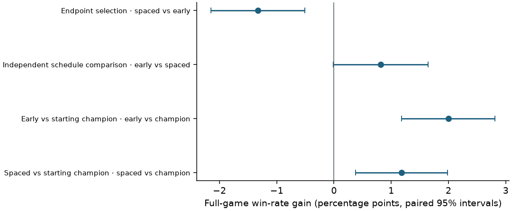

# When should we refit the current champion’s Act 3 combat?

**Status:** finished 19 November 2026. **Verdict:** The early-refit player became champion with 327 extra wins over its starting player on 16,384 independent worlds. The direct comparison with spaced refits was inconclusive.

## Question

Does concentrating the refits at strategy updates 2, 4 and 6 produce a stronger successor than waiting until 8, 16 and 22? In the [previous cadence comparison](2026-11-18-act3-boss-refits.md#results), the early specialists all passed. The frequent schedule also spent 5.5 times the teacher budget. The new parent already carries the specialist accepted at update 6. This tests further improvement from that stronger position.

## Design

Sid requested the two schedules on 19 November and suggested the new champion as their starting point. Both arms start from the 39.42% confirmed player. The following training and evaluation choices were fixed before the first update.

- Give each arm 24 strategy PPO updates at learning rate 0.0001 on the same 3,072 new worlds per update. Use one new matched training seed, the previous reward and optimizer recipe, and the same native environment. Both arms inherit the champion’s Act 3 specialist. They share exact strategy checkpoints until their deployed combat policies diverge.
- Give each arm three opportunities and 512 on-policy teacher worlds per opportunity, totalling 1,536 per arm. Match the teacher world seeds, fight-bank world seeds and whole-game gate worlds by opportunity number. Opportunity one uses the same rosters at early update 2 and spaced update 8. Subsequent opportunities use separate rosters. Each arm plays its own games.
- Use the same specialist recipe and admission rules as the previous study. Fit pooled action values from 24 reseeded searches of 1,000 simulations. First require more wins from 192 identical original Act 3 boss entries. An additional reseeded replay of each entry is descriptive. A candidate that advances must gain wins on 4,096 paired full games even under the least favourable assignment of unresolved outcomes. Adopt it for public Act 3 boss combat only. All other combat weights stay frozen.
- Greedy development checks every two updates use the usual 1,024 worlds and cannot select a checkpoint. Freeze both update-24 endpoints. Compare them on 16,384 unused, paired full games at seven evaluator processes and eight games per process. Nominate spaced if its least favourable paired gain over early is positive. Otherwise nominate early, including ties.
- On 16,384 more unused worlds compare the frozen schedules directly and each against the starting champion. An advantage for one schedule requires the same direction on selection and independent confirmation, with the confirmed paired 95% interval excluding zero even under unresolved outcomes. Promote only the primary nominee and only if its worst-case paired 95% lower bound against the starting champion exceeds zero. Identical deployed policies share one evaluation per panel. Record faults and cutoffs separately.
- Report outcomes and uncertainty for all six refit opportunities, both final panels and any new champion. This is one matched training seed from a stronger parent. It answers which schedule to use next from this checkpoint.

## Results

The early player won 41.34% of the independent games against 39.34% for the starting player. Both schedules improved on their parent.

| Panel | Candidate vs baseline | Paired full-game result |
|---|---|---|
| Endpoint selection | Spaced vs early | 6,612 vs 6,830 wins, 16,383/16,384 complete pairs, -1.33 points [-2.15, -0.51] on complete pairs. Full-cohort gain bounds [-1.34, -1.33] |
| Independent schedule comparison | Early vs spaced | 6,773 vs 6,639 wins, 16,384/16,384 complete pairs, +0.82 points [-0.01, +1.64] |
| Early vs starting champion | Early vs champion | 6,773 vs 6,446 wins, 16,384/16,384 complete pairs, +2.00 points [+1.18, +2.81] |
| Spaced vs starting champion | Spaced vs champion | 6,639 vs 6,446 wins, 16,384/16,384 complete pairs, +1.18 points [+0.38, +1.98] |

Each gate compares the proposed specialist with the combat policy active at that update.

| Schedule and update | Original fights | Reseeded fights | Full-game gate | Deployed |
|---|---|---|---|---|
| Early 2 | 67 vs 126 of 192, -30.73 points [-38.17, -23.29] | 69 vs 128 of 192, -30.73 points [-37.74, -23.72] | Did not advance | No |
| Early 4 | 84 vs 122 of 192, -19.79 points [-26.46, -13.12] | 86 vs 126 of 192, -20.83 points [-27.44, -14.23] | Did not advance | No |
| Early 6 | 123 vs 119 of 192, +2.08 points [-3.13, +7.29] | 119 vs 113 of 192, +3.12 points [-2.08, +8.33] | 1,655 vs 1,628 wins, 4,096/4,096 complete pairs, +0.66 points [-0.39, +1.71] | Yes |
| Spaced 8 | 119 vs 122 of 192, -1.56 points [-7.26, +4.13] | 123 vs 130 of 192, -3.65 points [-9.68, +2.39] | Did not advance | No |
| Spaced 16 | 109 vs 123 of 192, -7.29 points [-12.41, -2.18] | 116 vs 131 of 192, -7.81 points [-13.94, -1.69] | Did not advance | No |
| Spaced 22 | 111 vs 123 of 192, -6.25 points [-13.72, +1.22] | 102 vs 114 of 192, -6.25 points [-12.82, +0.32] | Did not advance | No |

## Conclusion

The early player passed the promotion rule. Its independent lead over the spaced player was 0.82 percentage points, with a paired 95% interval from −0.01 to +1.64. Both schedules received 1,536 teacher worlds and the same 73,728 strategy training worlds. The comparison covers one training seed from this parent.

## Next

Use the confirmed comparisons and the accepted head changes to choose the next training step.

## Log

- 19 November: fixed the new parent, matched world rosters, equal teacher budgets and decision rules before training. The undiverged trajectory can supply immutable checkpoints to both arms.

Code: `experiments/2026-11-19-refit-timing/`. Local run: `refit_timing_from_9700`.
