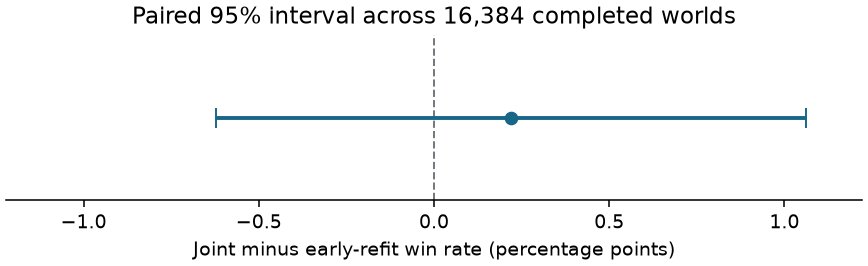

# Joint training against the early-refit champion

**Status** — finished 2026-11-20. **Verdict** — The early-refit player retains the title.

## Question

Does the [player that learned combat and strategy together](2026-11-19-online-combat.md) win more full games than the [current champion that learned a new final-boss fighter](2026-11-19-refit-timing.md)? Both descend from the same player. Their previous confirmation results came from different worlds. Joint won 419 games to early's 365 on the 1,024 familiar development worlds.

## Design

Sid requested this head-to-head on 20 November. Both players use their frozen update-24 weights. Each plays the same 16,384 previously unused Ironclad worlds on Ascension 0, Acts 1 to 3. Each chooses its highest-scoring legal move. Both use the same environment, menu rules, native build, seven evaluator processes and eight games per process.

The primary outcome is the difference in full-game wins, paired by world. Before opening the panel we chose the workstream's usual promotion rule. Promote joint only if its two-sided paired 95% interval has a positive lower bound even with unresolved outcomes assigned against it. Otherwise retain the incumbent. Report wins unique to each player, faults, decision limits and the number of complete pairs. This comparison can select between these two saved players. Each came from one training run.

## Results

Joint 6,852 wins, early refits 6,816 on 16,384 worlds. Joint minus early +0.22 percentage points (95% interval -0.62 to +1.06, 16,384 complete pairs).

| Player | Wins on assigned worlds | Won only by this player | Simulator faults | Decision limits |
|---|---:|---:|---:|---:|
| Early-refit champion | 6,816 (41.60%) | 2,463 | 0 | 0 |
| Joint player | 6,852 (41.82%) | 2,499 | 0 | 0 |

### Where the games diverged

This exploratory breakdown was added after the championship verdict. Counts and percentage-point changes use all complete pairs.

| Boss | Reached, joint vs early | Paired change [95% interval] | Cleared, joint vs early | Paired change [95% interval] |
|---|---:|---:|---:|---:|
| Act 1 | 16,019 vs 15,897 | +0.74 [+0.49, +1.00] | 15,348 vs 15,176 | +1.05 [+0.63, +1.47] |
| Act 2 | 14,682 vs 14,462 | +1.34 [+0.82, +1.86] | 11,645 vs 11,312 | +2.03 [+1.28, +2.79] |
| Act 3 | 10,807 vs 10,591 | +1.32 [+0.53, +2.11] | 6,852 vs 6,816 | +0.22 [-0.62, +1.06] |

Each player fought with the decks, health and potions it brought to those encounters.

## Conclusion

The early-refit player retains the title. The fresh games did not establish an advantage for either player. The lower 95% bound with unresolved outcomes assigned against joint was -0.62 percentage points. The interval measures variation across worlds for these two frozen players.

## Next

Use the early-refit champion as the default starting player when choosing the next experiment with Sid.

The code and settings are in `experiments/2026-11-20-joint-vs-early-refit/`. The local run is `joint_vs_early_refit_20261120`.

Evaluator source recorded at `e0bc5e68`.
