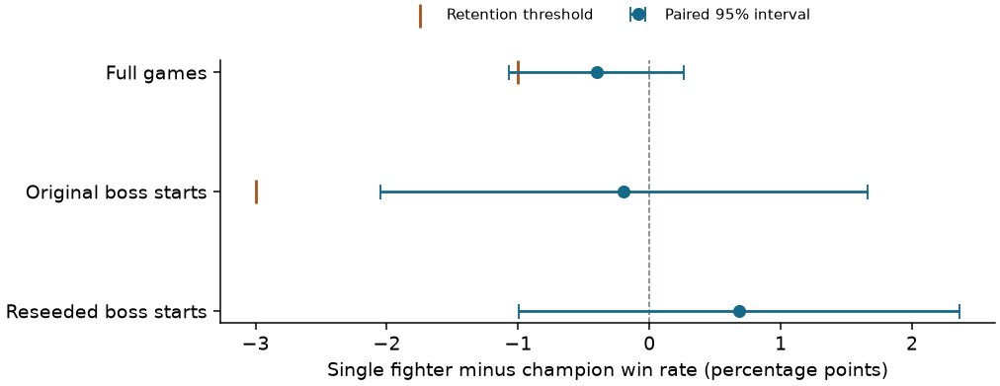
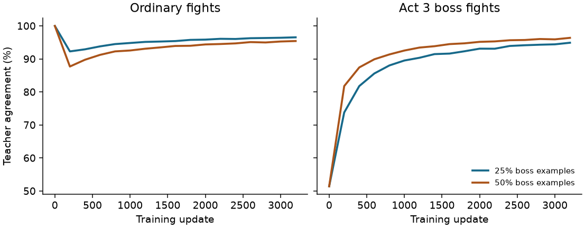

# One fighter for every encounter

**Status** — finished 20 November 2026. **Verdict** — one fighter retained final-boss strength within the three-point tolerance. Full-game retention was narrowly inconclusive, and the early-refit player remains champion.

## Question

Can one combat network retain the play strength of the [two-fighter champion](2026-11-20-joint-vs-early-refit.md)? Keeping its strategy network fixed isolates the change to combat.

## Design

Sid requested the experiment on 20 November. The following budgets, selection procedure and decision thresholds are study choices made before the run.

- Let the frozen champion choose its preferred moves in 4,096 training worlds. Sample up to 48 ordinary combat choices and 96 Act 3 boss choices per completed world. Exclude all examples from unresolved games. Use 512 separate worlds for imitation validation.
- Start the student from the ordinary fighter. Teach it the active teacher's scores over legal moves, with a temperature for each teacher calibrated on training data. The student has one combat network with the original public features and one fixed strategy network. It can see act and room in the usual game state.
- Try batches of 256 choices with 25% and 50% final-boss examples. Use learning rate 0.0001 and at most 3,200 updates. Check every 200 updates and select the step with the lowest equally weighted validation loss across the two types of combat. Select between those two saved players by full-game wins on the same 2,048 development worlds, assigning unresolved games against the challenger. Ties retain the 25% fit. Freeze the finalist before opening either performance test.
- Play the finalist and champion on the same 16,384 fresh Ironclad worlds, Ascension 0 through Act 3. Use exact preferred moves, the same seven evaluator processes and eight games per process. Compare wins within worlds with a two-sided paired 95% interval. Report incomplete games separately.
- From 2,048 other champion games freeze 1,024 distinct Act 3 boss entries, one per world. Both fighters get the same deck, health, relics, potions and starting randomness. Original entries are the boss outcome. Repeat each entry with one matched new draw as a diagnostic and report it separately.
- For this study, call strength retained if the lower 95% bounds clear **−1 percentage point on full games** and **−3 points on original boss entries**. These are practical tolerances chosen for the experiment. For champion promotion require a positive full-game lower bound, robust to incomplete games, and the boss retention criterion. Otherwise the incumbent keeps its title.

## Results

The single fighter won 66 fewer full games on 16,384 fresh worlds. The paired interval extends 0.07 percentage points beyond the one-point loss tolerance.

| Performance test | Single fighter | Champion | Student-only / champion-only wins | Paired win-rate change in points [95% interval] |
|---|---:|---:|---:|---:|
| Full games, 16,384 worlds | 6,763 (41.28%) | 6,829 (41.68%) | 1,513 / 1,579 | −0.40 [−1.07, +0.26] |
| Original Act 3 boss fights, 1,024 entries | 665 (64.94%) | 667 (65.14%) | 46 / 48 | −0.20 [−2.05, +1.66] |
| Same entries with new fight randomness, 1,024 replays | 694 (67.77%) | 687 (67.09%) | 42 / 35 | +0.68 [−1.00, +2.36] |

Every full game and boss replay finished with a valid outcome. The independent bank supplied 1,264 eligible boss entries from 2,048 completed champion games. The two fighters received identical starting states in every paired replay. The champion reproduced all 1,024 original wins and losses, and the new randomness produced a different opening state at every entry.

### Selecting the student

The 25% boss mixture was frozen for both independent performance tests. It won 864 games against the 50% mixture's 840 on 2,048 development worlds. The paired lead was 1.17 percentage points (95% interval −0.54 to +2.88). All games completed. This panel selected a finalist.

### Copying the teachers

The 4,096 completed training games supplied 196,240 ordinary and 98,718 boss choices. Validation covered 24,453 ordinary and 11,880 boss choices from 511 completed worlds. One of the 512 assigned validation games reached its decision limit and supplied no examples. Neither collection had a simulator fault.

| Fighter | Same ordinary move as teacher | Same final-boss move as teacher |
|---|---:|---:|
| Ordinary fighter before training | 24,453 / 24,453 (100.0%) | 6,110 / 11,880 (51.4%) |
| Student trained with 25% boss examples | 23,611 / 24,453 (96.6%) | 11,276 / 11,880 (94.9%) |
| Student trained with 50% boss examples | 23,336 / 24,453 (95.4%) | 11,452 / 11,880 (96.4%) |

Both fits had their lowest validation loss at update 3,200, the budget limit. The exported student has 4,597,764 parameters across its fighter and strategist, compared with 6,896,646 for the champion's three networks. The strategist's weights matched exactly, as did the standalone fighter used for the boss replays and the fighter packaged for full games.

## Conclusion

One combat network learned most of both teachers' move preferences and met the final-boss tolerance. The full-game interval is compatible with a small gain or a loss slightly above one point. The data do not establish either a clear full-game decline or retention at the chosen margin. The conclusion applies to this frozen student and one training collection.

## Next

The early-refit player remains the champion and the single fighter is saved. A longer 25% boss fit is a candidate for a new study because both teachers' validation losses were still falling at the training cap.

The settings and training code are in `experiments/2026-11-20-single-fighter/` at `80515a6`. The collector and first fit started before the scripts were committed. Both fits used the same fitter, and its checked source is archived with the run. The replay tool's explicit bank-range correction is at `fcee7d0`. Local run `single_fighter_from_f3c8`, with the deployable player in `finalist/player.pt`.
